# Entity-Relationship Diagram (ERD) Basis Data Belajar-Ku

> **Spesifikasi Teknis:** PostgreSQL 16 via Prisma ORM 5.22  
> **Format Notasi:** Mermaid.js Entity-Relationship Diagram (`erDiagram`)  
> **Kompatibilitas:** GitHub Markdown Viewer, VS Code Markdown Preview, Mermaid Live Editor, Obsidian  
> **Bahasa Pengantar:** Bahasa Indonesia Profesional  

---

## 1. Overview Arsitektur Basis Data Belajar-Ku

Basis data **Belajar-Ku** dirancang menggunakan pendekatan **Modular Monolith** yang menyatukan dua lini bisnis edutech utama dalam satu skema PostgreSQL terintegrasi:

1. **Lini B2C (Les Privat Terjadwal - `SESSION_BASED`):**
   - Transaksi antara Orang Tua Murid (`PARENT`) dan Guru Privat (`TUTOR`).
   - Meliputi jenjang PAUD, TK, SD, hingga SMP dengan opsi metode `ONLINE` atau `OFFLINE_VISIT`.
   - Menggunakan mekanisme *Distributed Time-Slot Locking* berbasis Redis (`lock:tutor:...` TTL 15 menit) saat *checkout* untuk mencegah *double-booking* jadwal guru.
   - Menghasilkan rangkaian entitas `BookingSession` otomatis setelah pembayaran lunas (`PAID`).

2. **Lini B2B (Pengadaan Dokumen Kurikulum Merdeka - `DELIVERABLE_BASED`):**
   - Transaksi antara Pimpinan/Bendahara Sekolah (`INSTITUTION`) dan Guru Ahli/Konsultan Pendidikan (`TUTOR`).
   - Menyediakan perangkat ajar siap pakai seperti Modul Ajar Kurikulum Merdeka, RPP Diferensiasi, dan Berkas LPJ Dana BOS.
   - Dilengkapi siklus serah-terima berkas digital via `OrderAttachment`, proteksi kuota revisi dokumen (`maxRevisions = 2`), dan mekanisme persetujuan serah-terima (`complete-deliverable`).

3. **Integritas Escrow Finansial & Pembagian Hasil (85% : 15%):**
   - Dana pembeli diamankan di tingkat `Order` hingga layanan selesai diserahterimakan.
   - Pencairan dana dilakukan secara *double-entry*:
     * **85% Honor Bersih Guru:** Dibukukan ke saldo aktif `tutor_profiles.walletBalance` dan dicatat permanen di `wallet_mutations`.
     * **15% Biaya Layanan Platform:** Dibukukan sebagai pendapatan bersih Belajar-Ku di `platform_revenue_ledgers`.
   - Invarian Neraca Terjamin:
     $$\text{GMV} = \text{Disbursed (85\%)} + \text{Platform Fee (15\%)} + \text{Held in Escrow} + \text{Total Refunded}$$

---

## 2. Diagram ERD Lengkap (Mermaid.js)

Diagram di bawah ini menggambarkan seluruh 15 entitas, atribut lengkap, penanda kunci (`PK`, `FK`, `UK`), dan kardinalitas relasi secara eksplisit.

```mermaid
erDiagram
    %% =========================================================================
    %% RELASI DOMAIN 1: IDENTITAS MULTI-ROLE & PROFIL
    %% =========================================================================
    User ||--o| TutorProfile : "memiliki_profil_guru"
    User ||--o{ StudentProfile : "mendaftarkan_anak"
    User ||--o| Cart : "memiliki_keranjang"

    %% =========================================================================
    %% RELASI DOMAIN 2: KATALOG & PENJADWALAN TUTOR
    %% =========================================================================
    Category ||--o{ TutorService : "mengkategorikan"
    TutorProfile ||--o{ TutorService : "menawarkan_layanan"
    TutorProfile ||--o{ TutorAvailability : "mengatur_ketersediaan"

    %% =========================================================================
    %% RELASI DOMAIN 3: KERANJANG, PESANAN & SESI LES
    %% =========================================================================
    Cart ||--o{ CartItem : "memuat_item_keranjang"
    TutorService ||--o{ CartItem : "layanan_dalam_keranjang"
    StudentProfile ||--o{ CartItem : "dipilihkan_pada_keranjang"

    User ||--o{ Order : "membuat_pesanan"
    Order ||--|{ OrderItem : "terdiri_atas_item"
    TutorService ||--o{ OrderItem : "layanan_yang_dipesan"
    TutorProfile ||--o{ OrderItem : "memenuhi_pesanan"
    StudentProfile ||--o{ OrderItem : "didaftarkan_pada_item"

    OrderItem ||--o{ BookingSession : "menghasilkan_jadwal_sesi"
    TutorProfile ||--o{ BookingSession : "memandu_sesi"
    StudentProfile ||--o{ BookingSession : "menghadiri_sesi"

    %% =========================================================================
    %% RELASI DOMAIN 4: SERAH TERIMA BERKAS MODUL B2B
    %% =========================================================================
    Order ||--o{ OrderAttachment : "lampiran_pesanan"
    OrderItem ||--o{ OrderAttachment : "lampiran_item"
    User ||--o{ OrderAttachment : "diunggah_oleh"

    %% =========================================================================
    %% RELASI DOMAIN 5: FINANSIAL, ESCROW & GOVERNAN SENGKETA
    %% =========================================================================
    BookingSession ||--o| WalletMutation : "mencairkan_honor_sesi"
    Order ||--o{ WalletMutation : "memicu_mutasi_b2b"
    TutorProfile ||--o{ WalletMutation : "menerima_kredit_honor"

    BookingSession ||--o| PlatformRevenueLedger : "mencatat_fee_sesi"
    Order ||--o{ PlatformRevenueLedger : "mencatat_fee_b2b"
    TutorProfile ||--o{ PlatformRevenueLedger : "dikenakan_potongan_platform"

    BookingSession ||--o{ SessionReport : "menjadi_objek_komplain"
    User ||--o{ SessionReport : "dilaporkan_oleh"
    User ||--o{ SessionReport : "diselesaikan_oleh_admin"

    %% =========================================================================
    %% DEFINISI ATRIBUT ENTITAS
    %% =========================================================================

    User {
        string id PK "Pengenal unik UUID"
        string name "Nama lengkap pengguna"
        string email UK "Email unik untuk login"
        string phone "Nomor WhatsApp aktif"
        string passwordHash "Hash kata sandi Bcrypt"
        string role "Enum: PARENT, TUTOR, ADMIN, INSTITUTION"
        string schoolName "Nama sekolah jika role INSTITUTION"
        boolean isActive "Status akun aktif atau dibekukan"
        datetime createdAt "Waktu akun dibuat"
        datetime updatedAt "Waktu akun diperbarui"
    }

    TutorProfile {
        string id PK "Pengenal unik UUID"
        string userId FK "Relasi unik 1-to-1 ke User"
        string bio "Deskripsi dan profil singkat guru"
        string education "Riwayat pendidikan formal guru"
        string address "Alamat domisili operasional guru"
        string teachingCredentials "Sertifikasi atau lisensi mengajar"
        string specialAccommodations "Keahlian inklusif atau ABK"
        boolean isVerified "Status verifikasi resmi administrator"
        float walletBalance "Saldo dompet aktif yang dapat ditarik"
        datetime createdAt "Waktu profil dibuat"
        datetime updatedAt "Waktu profil diperbarui"
    }

    StudentProfile {
        string id PK "Pengenal unik UUID"
        string parentId FK "ID akun orang tua pendaftar"
        string studentName "Nama lengkap anak atau murid"
        string gradeLevel "Enum: PAUD, TK, SD, SMP"
        string learningNotes "Catatan minat atau kebutuhan anak"
        datetime createdAt "Waktu anak didaftarkan"
        datetime updatedAt "Waktu data anak diperbarui"
    }

    Category {
        string id PK "Pengenal unik UUID"
        string name "Nama mata pelajaran atau dokumen"
        string targetGrade "Enum: PAUD, TK, SD, SMP"
        string categoryGroup "Enum kelompok rumpun keilmuan"
        string slug UK "Slug URL unik untuk pencarian"
        datetime createdAt "Waktu kategori dibuat"
        datetime updatedAt "Waktu kategori diperbarui"
    }

    TutorService {
        string id PK "Pengenal unik UUID"
        string tutorId FK "ID profil guru penyedia jasa"
        string categoryId FK "ID kategori keilmuan"
        string title "Judul layanan atau paket modul"
        string serviceType "Enum: SESSION_BASED atau DELIVERABLE_BASED"
        string teachingMode "Enum: ONLINE atau OFFLINE_VISIT"
        int durationMinutes "Durasi per sesi dalam menit"
        int sessionCount "Jumlah pertemuan per paket"
        float price "Harga kotor layanan dalam Rupiah"
        string description "Uraian silabus dan materi ajar"
        string_array syllabusHighlights "Poin ringkasan materi ajar"
        string specialAccommodations "Penyesuaian metode belajar"
        int estimatedDays "Estimasi pengerjaan dokumen dalam hari"
        string_array deliverableFormats "Format file dokumen luaran"
        int maxRevisions "Batas maksimal revisi dokumen"
        boolean isActive "Status tampil di katalog publik"
        datetime createdAt "Waktu layanan dipublikasikan"
        datetime updatedAt "Waktu layanan diperbarui"
    }

    TutorAvailability {
        string id PK "Pengenal unik UUID"
        string tutorId FK "ID profil guru"
        int dayOfWeek "Hari dalam pekan (1=Senin s.d. 7=Minggu)"
        string startTime "Jam mulai sesi (Format HH:mm)"
        string endTime "Jam selesai sesi (Format HH:mm)"
        boolean isActive "Status slot aktif dibuka"
        datetime createdAt "Waktu slot dibuat"
        datetime updatedAt "Waktu slot diperbarui"
    }

    Cart {
        string id PK "Pengenal unik UUID"
        string parentId FK "ID akun pengguna pemilik keranjang"
        datetime createdAt "Waktu keranjang dibuat"
        datetime updatedAt "Waktu keranjang diperbarui"
    }

    CartItem {
        string id PK "Pengenal unik UUID"
        string cartId FK "ID keranjang penampung"
        string serviceId FK "ID layanan yang dipilih"
        string studentId FK "ID anak yang didaftarkan"
        json selectedSlots "Daftar slot tanggal dan jam pilihan"
        string teachingAddress "Alamat belajar jika kunjungan rumah"
        string notes "Catatan kebutuhan khusus pemesan"
        datetime createdAt "Waktu item masuk keranjang"
        datetime updatedAt "Waktu item diperbarui"
    }

    Order {
        string id PK "Pengenal unik UUID"
        string invoiceNumber UK "Nomor tagihan transaksi resmi"
        string parentId FK "ID akun pengguna pembeli"
        float totalAmount "Total nilai pembayaran pesanan"
        string status "Enum: WAITING_PAYMENT, PAID, CANCELLED, EXPIRED"
        string serviceType "Enum: SESSION_BASED atau DELIVERABLE_BASED"
        string deliverableStatus "Enum status berkas modul B2B"
        int revisionCount "Jumlah pengajuan revisi berkas"
        int maxRevisions "Batas maksimal pengajuan revisi"
        string revisionNotes "Catatan koreksi revisi terakhir"
        datetime createdAt "Waktu pesanan dibuat"
        datetime updatedAt "Waktu status pesanan diperbarui"
    }

    OrderItem {
        string id PK "Pengenal unik UUID"
        string orderId FK "ID transaksi pesanan induk"
        string serviceId FK "ID layanan orisinal yang dibeli"
        string tutorId FK "ID profil guru pengampu"
        string studentId FK "ID profil anak yang mengikuti les"
        string serviceType "Tipe layanan snapshot checkout"
        float priceSnapshot "Snapshot harga saat pesanan dibuat"
        decimal platformFeePercent "Persentase komisi platform (15.00)"
        int totalSessions "Jumlah total sesi yang dijadwalkan"
        int completedSessions "Jumlah sesi yang telah diselesaikan"
        json selectedSlotsSnapshot "Snapshot jadwal sesi terpilih"
        string teachingAddress "Alamat belajar snapshot pesanan"
        string notes "Instruksi khusus snapshot pesanan"
        string deliverableStatus "Status deliverable tingkat item"
        int revisionCount "Jumlah revisi tingkat item"
        int maxRevisions "Batas maksimal revisi tingkat item"
        string revisionNotes "Catatan revisi tingkat item"
        datetime createdAt "Waktu item pesanan dicatat"
        datetime updatedAt "Waktu item pesanan diperbarui"
    }

    OrderAttachment {
        string id PK "Pengenal unik UUID"
        string orderId FK "ID pesanan berkas terkait"
        string orderItemId FK "ID item pesanan terkait"
        string fileName "Nama asli berkas yang diunggah"
        string fileUrl "URL atau path berkas tersimpan"
        int fileSize "Ukuran fisik berkas dalam byte"
        string mimeType "Tipe konten berkas dokumen"
        string uploadedById FK "ID pengguna pengunggah berkas"
        datetime createdAt "Waktu pengunggahan berkas"
    }

    BookingSession {
        string id PK "Pengenal unik UUID"
        string orderItemId FK "ID item pesanan induk"
        string tutorId FK "ID profil guru pengajar"
        string studentId FK "ID profil siswa peserta"
        int sessionNumber "Nomor urut pertemuan (1 s.d. N)"
        datetime scheduledDate "Tanggal kalender pelaksanaan sesi"
        string startTime "Jam mulai sesi (Format HH:mm)"
        string endTime "Jam selesai sesi (Format HH:mm)"
        string status "Enum: SCHEDULED, COMPLETED, RESCHEDULED, CANCELLED, DISPUTED"
        string learningReport "Jurnal materi dan asesmen siswa"
        datetime completedAt "Waktu penyelesaian sesi oleh guru"
        datetime createdAt "Waktu sesi dibuat dari sistem"
        datetime updatedAt "Waktu status sesi diperbarui"
    }

    WalletMutation {
        string id PK "Pengenal unik UUID"
        string tutorId FK "ID profil guru penerima dana"
        string sessionId FK "ID sesi sumber pencairan dana"
        string orderId FK "ID pesanan modul B2B sumber dana"
        string type "Enum: CREDIT_FROM_SESSION, CREDIT_FROM_DELIVERABLE, WITHDRAWAL"
        float grossAmount "Nilai bruto transaksi"
        float feeDeducted "Potongan komisi platform 15%"
        float netAmount "Pencairan bersih 85% ke saldo guru"
        float amount "Nilai nominal mutasi kredit saldo"
        datetime createdAt "Waktu mutasi dibukukan permanen"
    }

    PlatformRevenueLedger {
        string id PK "Pengenal unik UUID"
        string orderId FK "ID pesanan sumber komisi"
        string sessionId FK "ID sesi terkait bagi hasil"
        string tutorId FK "ID profil guru mitra"
        float grossAmount "Nilai bruto per transaksi atau sesi"
        float platformFee "Pendapatan komisi bersih platform 15%"
        datetime createdAt "Waktu bagi hasil direalisasikan"
    }

    SessionReport {
        string id PK "Pengenal unik UUID"
        string sessionId FK "ID sesi les yang dilaporkan"
        string reporterId FK "ID pengguna pelapor keluhan"
        string reason "Enum alasan komplain sengketa"
        string description "Kronologi rinci permasalahan"
        string evidenceUrl "Tautan bukti tangkapan layar"
        string status "Enum: PENDING, INVESTIGATING, RESOLVED, REJECTED"
        string adminNotes "Catatan pertimbangan administrator"
        string actionTaken "Enum putusan admin: REFUND, RELEASE, SUSPEND"
        string resolvedById FK "ID admin penyelesai sengketa"
        datetime resolvedAt "Waktu putusan resmi ditetapkan"
        datetime createdAt "Waktu laporan diajukan"
        datetime updatedAt "Waktu tiket diperbarui"
    }
```



---

## 3. Kamus Data Entitas Utama (Data Dictionary)

Tabel berikut merangkum 15 entitas utama basis data Belajar-Ku, fungsi bisnisnya, dan pemetaan relasi kunci asing (*Foreign Key*):

| # | Nama Tabel SQL | Model Prisma | Peran / Fungsi Bisnis Utama | Relasi Induk (Foreign Key) |
| :-: | :--- | :--- | :--- | :--- |
| **1** | `users` | `User` | Entitas induk autentikasi untuk semua pengguna (Parent, Tutor, Admin, Institution). | *None (Root Identity Table)* |
| **2** | `tutor_profiles` | `TutorProfile` | Data kualifikasi akademik, sertifikasi, status verifikasi admin, dan saldo dompet guru. | `userId` $\to$ `users.id` (1-to-1) |
| **3** | `student_profiles` | `StudentProfile` | Profil anak/murid yang didaftarkan orang tua untuk menghadiri les privat. | `parentId` $\to$ `users.id` |
| **4** | `categories` | `Category` | Master taksonomi mata pelajaran sekolah dan rumpun administrasi kurikulum. | *None (Master Data Table)* |
| **5** | `tutor_services` | `TutorService` | Etalase paket jasa les tatap muka/daring maupun berkas modul ajar B2B. | `tutorId` $\to$ `tutor_profiles.id`,<br>`categoryId` $\to$ `categories.id` |
| **6** | `tutor_availabilities` | `TutorAvailability` | Slot kalender ketersediaan hari dan jam mengajar mingguan guru. | `tutorId` $\to$ `tutor_profiles.id` |
| **7** | `carts` | `Cart` | Wadah keranjang aktif pengguna sebelum melakukan transaksi *checkout*. | `parentId` $\to$ `users.id` (1-to-1) |
| **8** | `cart_items` | `CartItem` | Rincian baris pesanan sementara beserta pilihan slot jadwal dan alamat les. | `cartId` $\to$ `carts.id`,<br>`serviceId` $\to$ `tutor_services.id`,<br>`studentId` $\to$ `student_profiles.id` |
| **9** | `orders` | `Order` | Faktur transaksi induk pembeli yang bertindak sebagai brankas *escrow* dana. | `parentId` $\to$ `users.id` |
| **10** | `order_items` | `OrderItem` | Baris rincian pesanan dengan snapshot harga permanen dan kuota pertemuan/revisi. | `orderId` $\to$ `orders.id`,<br>`serviceId` $\to$ `tutor_services.id`,<br>`tutorId` $\to$ `tutor_profiles.id`,<br>`studentId` $\to$ `student_profiles.id` |
| **11** | `order_attachments` | `OrderAttachment` | Berkas pengiriman modul/dokumen ajar digital antara guru dan pihak sekolah. | `orderId` $\to$ `orders.id`,<br>`orderItemId` $\to$ `order_items.id`,<br>`uploadedById` $\to$ `users.id` |
| **12** | `booking_sessions` | `BookingSession` | Jadwal fisik pertemuan sesi les individu yang digenerate otomatis pasca pelunasan. | `orderItemId` $\to$ `order_items.id`,<br>`tutorId` $\to$ `tutor_profiles.id`,<br>`studentId` $\to$ `student_profiles.id` |
| **13** | `wallet_mutations` | `WalletMutation` | Buku besar (*ledger*) pencairan honor bersih 85% ke dompet guru secara permanen. | `tutorId` $\to$ `tutor_profiles.id`,<br>`sessionId` $\to$ `booking_sessions.id`,<br>`orderId` $\to$ `orders.id` |
| **14** | `platform_revenue_ledgers` | `PlatformRevenueLedger` | Buku besar realisasi potongan komisi pendapatan 15% milik platform Belajar-Ku. | `orderId` $\to$ `orders.id`,<br>`sessionId` $\to$ `booking_sessions.id`,<br>`tutorId` $\to$ `tutor_profiles.id` |
| **15** | `session_reports` | `SessionReport` | Meja komplain sengketa operasional sesi les untuk investigasi dan putusan admin. | `sessionId` $\to$ `booking_sessions.id`,<br>`reporterId` $\to$ `users.id`,<br>`resolvedById` $\to$ `users.id` |

---

## 4. Panduan Ekspor Diagram ke Gambar (SVG / PNG)

Diagram Mermaid di atas dapat diekspor langsung menjadi file gambar beresolusi tinggi untuk keperluan presentasi arsitektur, laporan pengujian, atau repositori dokumentasi.

### 4.1. Ekspor Menggunakan Mermaid CLI (`@mermaid-js/mermaid-cli`)

Jalankan perintah berikut di terminal root proyek:

```bash
# 1. Ekspor ke format PNG resolusi standar
npx @mermaid-js/mermaid-cli -i ERD_DATABASE_BELAJAR_KU.md -o public/erd-belajar-ku.png

# 2. Ekspor ke format SVG (vektor tajam tanpa pecah untuk dokumen cetak)
npx @mermaid-js/mermaid-cli -i ERD_DATABASE_BELAJAR_KU.md -o public/erd-belajar-ku.svg

# 3. Ekspor ke format PNG dengan skala tinggi (Skala 2x, background putih)
npx @mermaid-js/mermaid-cli -i ERD_DATABASE_BELAJAR_KU.md -o public/erd-belajar-ku-hd.png -s 2 -b white
```

### 4.2. Visualisasi Langsung di VS Code & GitHub
- **Visual Studio Code:** Pasang ekstensi *Markdown Preview Mermaid Support* (`bierner.markdown-mermaid`) untuk melihat visualisasi diagram interaktif secara langsung.
- **GitHub / GitLab:** Blok kode ````mermaid ```` pada dokumen ini secara otomatis dirender sebagai diagram interaktif oleh *native markdown engine*.
- **Mermaid Live Editor:** Salin blok kode `erDiagram` di bagian 2 ke [https://mermaid.live](https://mermaid.live) untuk pengeditan visual *real-time*.

---

*Dokumentasi ini disusun oleh Principal Database Architect Belajar-Ku dan telah divalidasi bebas dari kesalahan sintaksis.*
