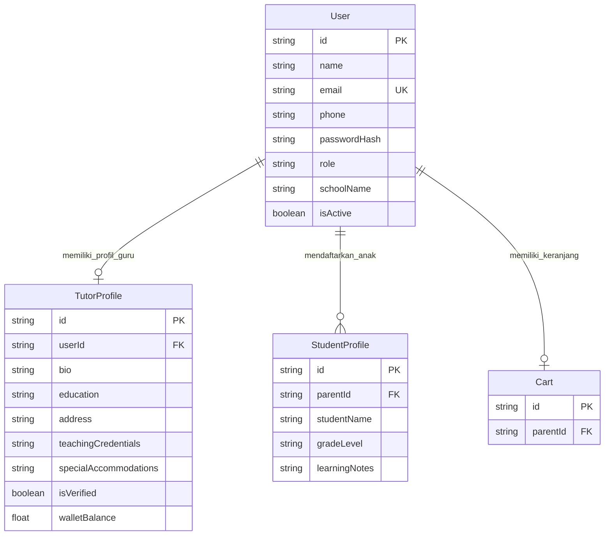
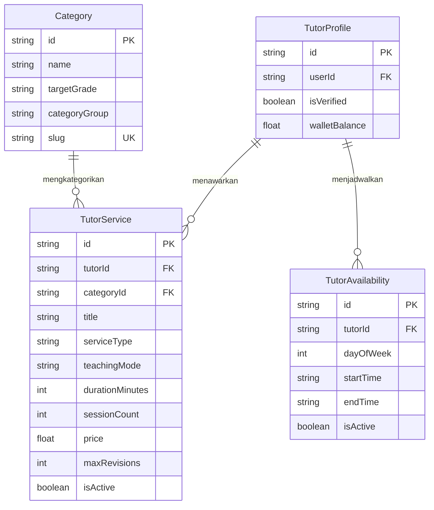
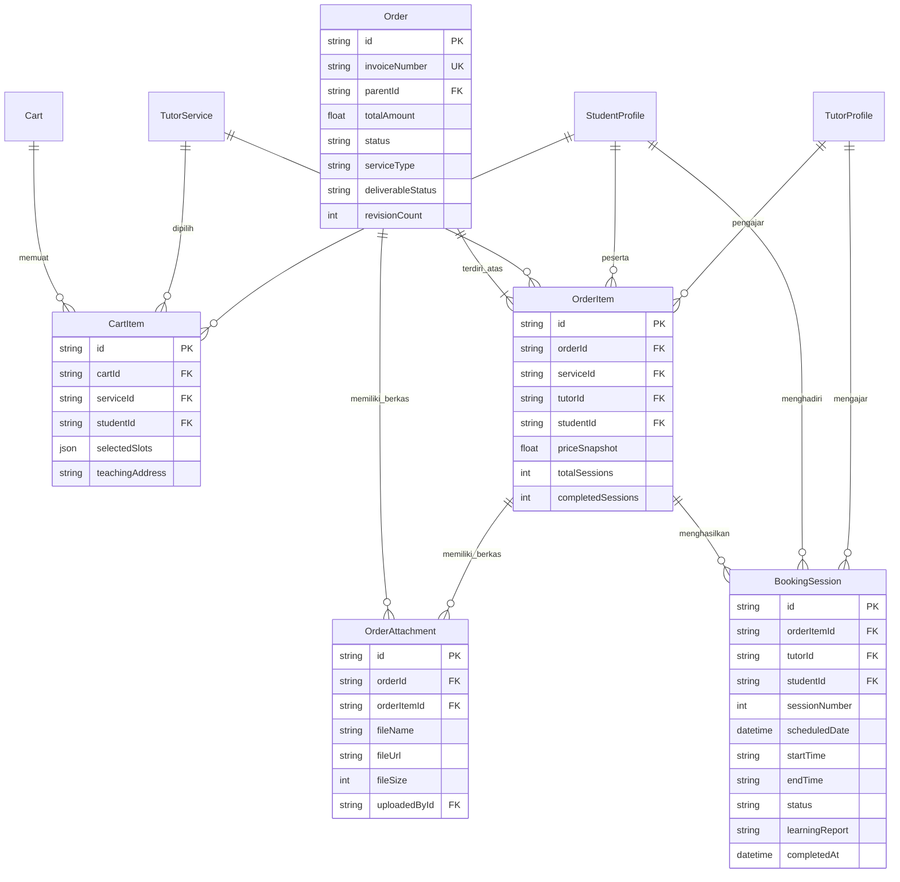
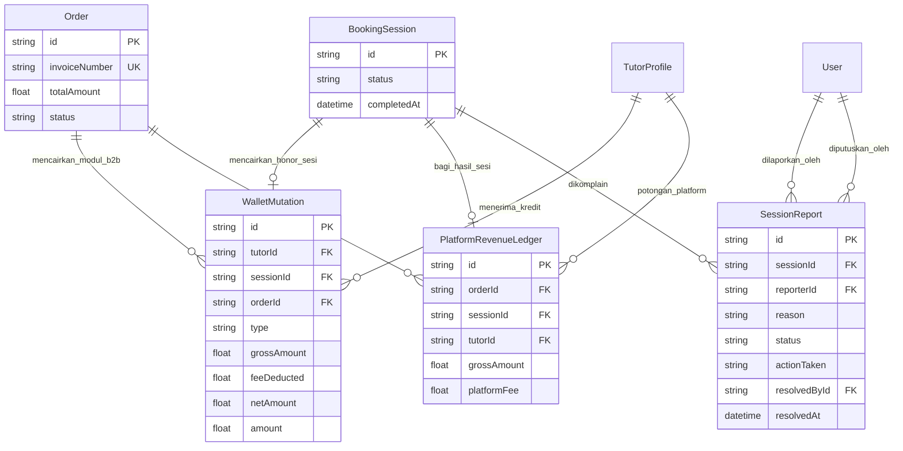

# Dokumentasi Arsitektur Database & Skema Entity-Relationship (ERD) Belajar-Ku

> **Target Platform:** Belajar-Ku EdTech API & Web Platform  
> **Database Engine:** PostgreSQL 16 (via Prisma ORM 5.22)  
> **Format Diagram:** Mermaid.js Entity-Relationship Diagram (`erDiagram`)  
> **Kompatibilitas Rendering:** GitHub Markdown, VS Code Markdown Preview, Mermaid Live Editor, Obsidian  
> **Bahasa Pengantar:** Bahasa Indonesia Profesional  

---

## Daftar Isi
1. [Ringkasan Eksekutif Arsitektur Basis Data](#1-ringkasan-eksekutif-arsitektur-basis-data)
2. [Master Entity-Relationship Diagram (ERD)](#2-master-entity-relationship-diagram-erd)
3. [Diagram ERD Berdasarkan Sub-Domain Sistem](#3-diagram-erd-berdasarkan-sub-domain-sistem)
   - [3.1. Sub-Domain Autentikasi, Akun & Multi-Profil](#31-sub-domain-autentikasi-akun--multi-profil)
   - [3.2. Sub-Domain Katalog, Layanan & Penjadwalan Tutor](#32-sub-domain-katalog-layanan--penjadwalan-tutor)
   - [3.3. Sub-Domain Keranjang, Pesanan & Sesi Booking](#33-sub-domain-keranjang-pesanan--sesi-booking)
   - [3.4. Sub-Domain Finansial, Dompet Escrow & Governan Sengketa](#34-sub-domain-finansial-dompet-escrow--governan-sengketa)
4. [Kamus Data Lengkap (Data Dictionary)](#4-kamus-data-lengkap-data-dictionary)
   - [4.1. Tabel `users` (Model User)](#41-tabel-users-model-user)
   - [4.2. Tabel `tutor_profiles` (Model TutorProfile)](#42-tabel-tutor_profiles-model-tutorprofile)
   - [4.3. Tabel `student_profiles` (Model StudentProfile)](#43-tabel-student_profiles-model-studentprofile)
   - [4.4. Tabel `categories` (Model Category)](#44-tabel-categories-model-category)
   - [4.5. Tabel `tutor_services` (Model TutorService)](#45-tabel-tutor_services-model-tutorservice)
   - [4.6. Tabel `tutor_availabilities` (Model TutorAvailability)](#46-tabel-tutor_availabilities-model-tutoravailability)
   - [4.7. Tabel `carts` (Model Cart)](#47-tabel-carts-model-cart)
   - [4.8. Tabel `cart_items` (Model CartItem)](#48-tabel-cart_items-model-cartitem)
   - [4.9. Tabel `orders` (Model Order)](#49-tabel-orders-model-order)
   - [4.10. Tabel `order_items` (Model OrderItem)](#410-tabel-order_items-model-orderitem)
   - [4.11. Tabel `order_attachments` (Model OrderAttachment)](#411-tabel-order_attachments-model-orderattachment)
   - [4.12. Tabel `booking_sessions` (Model BookingSession)](#412-tabel-booking_sessions-model-bookingsession)
   - [4.13. Tabel `wallet_mutations` (Model WalletMutation)](#413-tabel-wallet_mutations-model-walletmutation)
   - [4.14. Tabel `platform_revenue_ledgers` (Model PlatformRevenueLedger)](#414-tabel-platform_revenue_ledgers-model-platformrevenueledger)
   - [4.15. Tabel `session_reports` (Model SessionReport)](#415-tabel-session_reports-model-sessionreport)
5. [Katalog & Referensi Nilai Enumerasi (Enums)](#5-katalog--referensi-nilai-enumerasi-enums)
6. [Matriks Relasi, Kardinalitas & Referential Integrity](#6-matriks-relasi-kardinalitas--referential-integrity)
7. [Aturan Bisnis & Keutuhan Transaksional (ACID & Escrow)](#7-aturan-bisnis--keutuhan-transaksional-acid--escrow)

---

## 1. Ringkasan Eksekutif Arsitektur Basis Data

Basis data **Belajar-Ku** dirancang menggunakan arsitektur **Modular Monolith** berbasis PostgreSQL yang dikelola secara deklaratif melalui Prisma ORM. Skema ini mengintegrasikan dua model bisnis utama:
1. **B2C (Business-to-Consumer):** Layanan les privat terjadwal berbasis sesi (`SESSION_BASED`) antara Orang Tua (`PARENT`) dan Guru Privat (`TUTOR`) untuk jenjang PAUD, TK, SD, hingga SMP.
2. **B2B (Business-to-Business):** Pengadaan modul ajar, dokumen akreditasi, dan perangkat pembelajaran kurikulum merdeka berbasis deliverable (`DELIVERABLE_BASED`) oleh Institusi Sekolah (`INSTITUTION`) kepada Guru Ahli/Konsultan (`TUTOR`).

### Karakteristik Desain Utama:
- **Zero-Loss Escrow Ledger:** Dana pembayaran pembeli ditahan secara aman di level `Order`. Bagi hasil **85% untuk Tutor** dan **15% untuk Platform Fee** dicatat secara *double-entry* pada tabel `wallet_mutations` dan `platform_revenue_ledgers` hanya ketika sesi selesai dikonfirmasi atau deliverable modul disetujui.
- **Distributed Time-Slot Locking:** Penjadwalan sesi guru dilindungi oleh kunci atomik Redis (`SETNX` dengan TTL 900 detik) untuk mencegah *double-booking* saat *checkout*.
- **Multi-Role RBAC terisolasi:** Tabel `users` bertindak sebagai sentral identitas autentikasi, yang memiliki asosiasi profil khusus terisolasi (`tutor_profiles`, `student_profiles`, serta field institusi `schoolName`).
- **Audit Trails & Dispute Resolution:** Setiap sengketa sesi les tercatat di `session_reports` dengan pelacakan status resolusi admin (`REFUND_TO_PARENT`, `RELEASE_FUNDS_TO_TUTOR`, atau `SUSPEND_USER`).

---

## 2. Master Entity-Relationship Diagram (ERD)

Diagram di bawah ini menampilkan keseluruhan 15 entitas basis data Belajar-Ku, atribut kunci (PK, FK, UK), dan kardinalitas relasi antar entitas.

```mermaid
erDiagram
    User ||--o| TutorProfile : "memiliki_profil_guru"
    User ||--o{ StudentProfile : "mendaftarkan_anak"
    User ||--o| Cart : "memiliki_keranjang"
    User ||--o{ Order : "membuat_pesanan"
    User ||--o{ SessionReport : "melaporkan_kendala"
    User ||--o{ SessionReport : "menyelesaikan_sengketa"
    User ||--o{ OrderAttachment : "mengunggah_lampiran"

    Category ||--o{ TutorService : "mengkategorikan"
    TutorProfile ||--o{ TutorService : "menawarkan_layanan"
    TutorProfile ||--o{ TutorAvailability : "mengatur_ketersediaan"
    TutorProfile ||--o{ OrderItem : "memenuhi_item_pesanan"
    TutorProfile ||--o{ BookingSession : "mengajar_sesi"
    TutorProfile ||--o{ WalletMutation : "menerima_mutasi_saldo"
    TutorProfile ||--o{ PlatformRevenueLedger : "dikenakan_potongan_platform"

    StudentProfile ||--o{ CartItem : "dipilihkan_pada_keranjang"
    StudentProfile ||--o{ OrderItem : "didaftarkan_pada_item"
    StudentProfile ||--o{ BookingSession : "menghadiri_sesi"

    Cart ||--o{ CartItem : "memuat_item_keranjang"
    TutorService ||--o{ CartItem : "layanan_dalam_keranjang"

    Order ||--|{ OrderItem : "terdiri_atas_item"
    TutorService ||--o{ OrderItem : "layanan_yang_dipesan"
    Order ||--o{ OrderAttachment : "lampiran_pada_pesanan"
    OrderItem ||--o{ OrderAttachment : "lampiran_pada_item"
    Order ||--o{ WalletMutation : "memicu_mutasi_b2b"
    Order ||--o{ PlatformRevenueLedger : "mencatat_pendapatan_platform"

    OrderItem ||--o{ BookingSession : "menghasilkan_jadwal_sesi"
    BookingSession ||--o| WalletMutation : "mencairkan_honor_sesi"
    BookingSession ||--o| PlatformRevenueLedger : "mencatat_fee_sesi"
    BookingSession ||--o{ SessionReport : "menjadi_objek_komplain"

    User {
        string id PK "UUID Primary Key"
        string name "Nama Pengguna"
        string email UK "Email Unik Login"
        string phone "Nomor Telepon / WhatsApp"
        string passwordHash "Bcrypt Hash Password"
        string role "Enum: PARENT, TUTOR, ADMIN, INSTITUTION"
        string schoolName "Nama Sekolah (Role INSTITUTION)"
        boolean isActive "Status Akun Aktif"
        datetime createdAt "Waktu Pendaftaran"
        datetime updatedAt "Waktu Terakhir Diperbarui"
    }

    TutorProfile {
        string id PK "UUID Primary Key"
        string userId FK "Relasi Unik 1-to-1 ke User"
        string bio "Deskripsi / Profil Singkat Guru"
        string education "Riwayat Pendidikan Formal"
        string address "Alamat Domisili Guru"
        string teachingCredentials "Sertifikasi / Lisensi Mengajar"
        string specialAccommodations "Keahlian Khusus ABK / Isyarat"
        boolean isVerified "Verifikasi Resmi Administrator"
        float walletBalance "Saldo Dompet Aktif (IDR)"
        datetime createdAt "Waktu Pembuatan Profil"
        datetime updatedAt "Waktu Pembaruan Profil"
    }

    StudentProfile {
        string id PK "UUID Primary Key"
        string parentId FK "ID Akun Orang Tua (User)"
        string studentName "Nama Lengkap Anak / Murid"
        string gradeLevel "Enum: PAUD, TK, SD, SMP"
        string learningNotes "Catatan Karakter / Kebutuhan Belajar"
        datetime createdAt "Waktu Didaftarkan"
        datetime updatedAt "Waktu Pembaruan Data Anak"
    }

    Category {
        string id PK "UUID Primary Key"
        string name "Nama Mata Pelajaran / Administrasi"
        string targetGrade "Enum: PAUD, TK, SD, SMP"
        string categoryGroup "Enum Grup Kategori Keilmuan"
        string slug UK "Slug URL Unik untuk Pencarian"
        datetime createdAt "Waktu Dibuat"
        datetime updatedAt "Waktu Diperbarui"
    }

    TutorService {
        string id PK "UUID Primary Key"
        string tutorId FK "ID Profil Guru Penyedia Jasa"
        string categoryId FK "ID Kategori Terkait"
        string title "Judul Layanan / Paket Les / Dokumen"
        string serviceType "Enum: SESSION_BASED atau DELIVERABLE_BASED"
        string teachingMode "Enum: ONLINE atau OFFLINE_VISIT"
        int durationMinutes "Durasi Per Sesi (Menit)"
        int sessionCount "Jumlah Pertemuan Per Paket"
        float price "Harga Total Paket / Jasa (IDR)"
        string description "Deskripsi Rinci Silabus / Layanan"
        string_array syllabusHighlights "Poin Utama Materi Pembelajaran"
        string specialAccommodations "Akomodasi Khusus Siswa"
        int estimatedDays "Estimasi Pengerjaan Dokumen (Hari)"
        string_array deliverableFormats "Format File (PDF, DOCX, dsb)"
        int maxRevisions "Batas Maksimal Revisi Dokumen"
        boolean isActive "Status Etalase Aktif"
        datetime createdAt "Waktu Publikasi Layanan"
        datetime updatedAt "Waktu Perubahan Terakhir"
    }

    TutorAvailability {
        string id PK "UUID Primary Key"
        string tutorId FK "ID Profil Guru"
        int dayOfWeek "Hari (1=Senin s.d. 7=Minggu)"
        string startTime "Jam Mulai (Format HH:mm)"
        string endTime "Jam Selesai (Format HH:mm)"
        boolean isActive "Status Ketersediaan Slot Aktif"
        datetime createdAt "Waktu Slot Dibuat"
        datetime updatedAt "Waktu Slot Diperbarui"
    }

    Cart {
        string id PK "UUID Primary Key"
        string parentId FK "ID User Pemilik Keranjang (UK)"
        datetime createdAt "Waktu Keranjang Dibuat"
        datetime updatedAt "Waktu Pembaruan Terakhir"
    }

    CartItem {
        string id PK "UUID Primary Key"
        string cartId FK "ID Keranjang Induk"
        string serviceId FK "ID Layanan Guru yang Dipilih"
        string studentId FK "ID Anak yang Didaftarkan (Opsional)"
        json selectedSlots "Daftar Slot Tanggal & Jam Terpilih"
        string teachingAddress "Alamat Belajar Siswa (Kunjungan)"
        string notes "Catatan Tambahan untuk Guru"
        datetime createdAt "Waktu Item Masuk Keranjang"
        datetime updatedAt "Waktu Perubahan Item"
    }

    Order {
        string id PK "UUID Primary Key"
        string invoiceNumber UK "Nomor Invoice Transaksi Unik"
        string parentId FK "ID User Pembeli (Parent/Institution)"
        float totalAmount "Total Nilai Transaksi (IDR)"
        string status "Enum: WAITING_PAYMENT, PAID, CANCELLED, EXPIRED"
        string serviceType "Enum: SESSION_BASED atau DELIVERABLE_BASED"
        string deliverableStatus "Enum Status Pengerjaan Modul B2B"
        int revisionCount "Jumlah Revisi yang Telah Diajukan"
        int maxRevisions "Batas Revisi Maksimal Dokumen"
        string revisionNotes "Catatan / Umpan Balik Revisi"
        datetime createdAt "Waktu Pembuatan Pesanan"
        datetime updatedAt "Waktu Pembaruan Terakhir"
    }

    OrderItem {
        string id PK "UUID Primary Key"
        string orderId FK "ID Pesanan Induk"
        string serviceId FK "ID Layanan yang Dipesan"
        string tutorId FK "ID Profil Guru Penerima Order"
        string studentId FK "ID Anak Siswa (Opsional)"
        string serviceType "Tipe Layanan pada Saat Checkout"
        float priceSnapshot "Snapshot Harga saat Checkout (IDR)"
        decimal platformFeePercent "Persentase Fee Platform (15.00)"
        int totalSessions "Total Sesi yang Harus Dilaksanakan"
        int completedSessions "Jumlah Sesi yang Telah Selesai"
        json selectedSlotsSnapshot "Snapshot Tanggal & Jam Sesi Terjadwal"
        string teachingAddress "Alamat Belajar Snapshot"
        string notes "Catatan Khusus saat Pembelian"
        string deliverableStatus "Status Deliverable per Item"
        int revisionCount "Jumlah Revisi per Item"
        int maxRevisions "Maksimal Revisi per Item"
        string revisionNotes "Catatan Revisi per Item"
        datetime createdAt "Waktu Item Dicatat"
        datetime updatedAt "Waktu Perubahan Terakhir"
    }

    OrderAttachment {
        string id PK "UUID Primary Key"
        string orderId FK "ID Pesanan Terkait"
        string orderItemId FK "ID Item Pesanan Terkait (Opsional)"
        string fileName "Nama Berkas Asli yang Diunggah"
        string fileUrl "URL / Lokasi Penyimpanan File"
        int fileSize "Ukuran Berkas dalam Byte"
        string mimeType "Tipe MIME Dokumen (e.g. application/pdf)"
        string uploadedById FK "ID Pengguna Pengunggah Berkas"
        datetime createdAt "Waktu Pengunggahan Berkas"
    }

    BookingSession {
        string id PK "UUID Primary Key"
        string orderItemId FK "ID Item Pesanan Induk"
        string tutorId FK "ID Profil Guru Pengajar"
        string studentId FK "ID Profil Siswa Peserta Sesi"
        int sessionNumber "Nomor Urut Pertemuan (1 s.d. N)"
        datetime scheduledDate "Tanggal Kalender Pelaksanaan Sesi"
        string startTime "Jam Mulai Sesi (Format HH:mm)"
        string endTime "Jam Selesai Sesi (Format HH:mm)"
        string status "Enum: SCHEDULED, COMPLETED, RESCHEDULED, CANCELLED, DISPUTED"
        string learningReport "Jurnal Materi & Evaluasi Pembelajaran"
        datetime completedAt "Waktu Penyelesaian Sesi oleh Guru"
        datetime createdAt "Waktu Sesi Dibuat Otomatis"
        datetime updatedAt "Waktu Pembaruan Status Sesi"
    }

    WalletMutation {
        string id PK "UUID Primary Key"
        string tutorId FK "ID Profil Guru Penerima Mutasi"
        string sessionId FK "ID Sesi Pembayaran (Relasi Unik 1-to-1)"
        string orderId FK "ID Pesanan Pembayaran Modul B2B"
        string type "Enum: CREDIT_FROM_SESSION, CREDIT_FROM_DELIVERABLE, WITHDRAWAL"
        float grossAmount "Nilai Kotor Transaksi (IDR)"
        float feeDeducted "Potongan Komisi Platform 15% (IDR)"
        float netAmount "Pencairan Bersih Masuk Saldo 85% (IDR)"
        float amount "Nilai Mutasi Nominal Bersih (IDR)"
        datetime createdAt "Waktu Pencatatan Mutasi Kas"
    }

    PlatformRevenueLedger {
        string id PK "UUID Primary Key"
        string orderId FK "ID Pesanan Induk"
        string sessionId FK "ID Sesi Booking Terkait (Relasi Unik 1-to-1)"
        string tutorId FK "ID Profil Guru Terkait"
        float grossAmount "Nilai Kotor Transaksi (IDR)"
        float platformFee "Pendapatan Bersih Platform 15% (IDR)"
        datetime createdAt "Waktu Realisasi Bagi Hasil"
    }

    SessionReport {
        string id PK "UUID Primary Key"
        string sessionId FK "ID Sesi yang Dikomplain"
        string reporterId FK "ID Pengguna yang Melaporkan"
        string reason "Enum Alasan Komplain / Sengketa"
        string description "Deskripsi Permasalahan / Kronologi"
        string evidenceUrl "URL Bukti Pendukung (Tangkapan Layar/Foto)"
        string status "Enum: PENDING, INVESTIGATING, RESOLVED, REJECTED"
        string adminNotes "Catatan Tindak Lanjut Administrator"
        string actionTaken "Enum Putusan Admin: REFUND, RELEASE, SUSPEND"
        string resolvedById FK "ID Administrator Penyelesai Kasus"
        datetime resolvedAt "Waktu Putusan Ditetapkan"
        datetime createdAt "Waktu Pelaporan Diajukan"
        datetime updatedAt "Waktu Pembaruan Tiket"
    }
```

---

## 3. Diagram ERD Berdasarkan Sub-Domain Sistem

Untuk mempermudah analisis arsitektural dan implementasi modul terisolasi, skema basis data dibagi menjadi 4 diagram fokus sub-domain:

### 3.1. Sub-Domain Autentikasi, Akun & Multi-Profil
Mengelola kredensial masuk pengguna (`User`), profil guru terverifikasi (`TutorProfile`), daftar profil anak bagi orang tua (`StudentProfile`), serta wadah keranjang belanja pengguna (`Cart`).

---

### 3.2. Sub-Domain Katalog, Layanan & Penjadwalan Tutor
Mengelola klasifikasi keilmuan (`Category`), rincian penawaran jasa guru les maupun modul B2B (`TutorService`), serta kalender slot ketersediaan mingguan guru (`TutorAvailability`).

---

### 3.3. Sub-Domain Keranjang, Pesanan & Sesi Booking
Mengelola antrean item keranjang (`CartItem`), pembuatan pesanan transaksi (`Order`), baris perincian pesanan (`OrderItem`), pembentukan jadwal pertemuan belajar tatap muka/daring (`BookingSession`), serta berkas modul yang diserahterimakan (`OrderAttachment`).

---

### 3.4. Sub-Domain Finansial, Dompet Escrow & Governan Sengketa
Mengelola pembagian pendapatan otomatis 85%:15% pasca penyelesaian sesi atau deliverable (`WalletMutation` dan `PlatformRevenueLedger`), serta eskalasi tiket sengketa pelanggan ke meja pengawasan admin (`SessionReport`).

---

## 4. Kamus Data Lengkap (Data Dictionary)

Berikut adalah spesifikasi mendalam untuk ke-15 tabel basis data, mencakup nama kolom, tipe data PostgreSQL dan Prisma, status nullability, default/constraint, serta penjelasan fungsional bisnisnya.

---

### 4.1. Tabel `users` (Model User)
Tabel pusat identitas dan autentikasi untuk seluruh aktor sistem (Parent, Tutor, Admin, Institution).

| Kolom | Tipe PostgreSQL | Tipe Prisma | Nullable | Default / Constraints | Keterangan Bisnis |
| :--- | :--- | :--- | :---: | :--- | :--- |
| `id` | `VARCHAR(36)` | `String` | NO | `PRIMARY KEY`, UUID v4 | Pengenal unik pengguna. |
| `name` | `VARCHAR(255)` | `String` | NO | - | Nama lengkap resmi pengguna. |
| `email` | `VARCHAR(255)` | `String` | NO | `UNIQUE`, Indexed | Alamat email unik untuk otentikasi login. |
| `phone` | `VARCHAR(30)` | `String` | NO | - | Nomor kontak WhatsApp aktif pengguna. |
| `passwordHash` | `VARCHAR(255)` | `String` | NO | - | Hash sandi tersimpan (Bcrypt / Argon2). |
| `role` | `VARCHAR(50)` | `Role` (Enum) | NO | `'PARENT'` | Peran pengguna (`PARENT`, `TUTOR`, `ADMIN`, `INSTITUTION`). |
| `schoolName` | `VARCHAR(255)` | `String?` | YES | `NULL` | Nama sekolah/yayasan (khusus role `INSTITUTION`). |
| `isActive` | `BOOLEAN` | `Boolean` | NO | `TRUE` | Flag suspensi akun oleh admin (`FALSE` = dibekukan). |
| `createdAt` | `TIMESTAMPTZ` | `DateTime` | NO | `NOW()` | Waktu pertama kali akun didaftarkan. |
| `updatedAt` | `TIMESTAMPTZ` | `DateTime` | NO | `updatedAt` | Waktu pembaruan profil pengguna terakhir. |

---

### 4.2. Tabel `tutor_profiles` (Model TutorProfile)
Tabel data kualifikasi, riwayat pendidikan, saldo dompet, dan status verifikasi seorang tutor.

| Kolom | Tipe PostgreSQL | Tipe Prisma | Nullable | Default / Constraints | Keterangan Bisnis |
| :--- | :--- | :--- | :---: | :--- | :--- |
| `id` | `VARCHAR(36)` | `String` | NO | `PRIMARY KEY`, UUID v4 | Pengenal unik profil guru. |
| `userId` | `VARCHAR(36)` | `String` | NO | `UNIQUE`, `FK` -> `users(id)` | Relasi 1-to-1 dengan akun user guru (`onDelete: Cascade`). |
| `bio` | `TEXT` | `String` | NO | - | Deskripsi pengalaman dan filosofi mengajar guru. |
| `education` | `VARCHAR(255)` | `String` | NO | - | Riwayat pendidikan formal (universitas/jurusan). |
| `address` | `TEXT` | `String` | NO | - | Alamat domisili operasional guru. |
| `teachingCredentials` | `TEXT` | `String?` | YES | `NULL` | Sertifikasi pengajar (e.g. Lisensi Tahsin, PGPAUD, PLB). |
| `specialAccommodations` | `TEXT` | `String?` | YES | `NULL` | Kompetensi khusus ABK (e.g. BISINDO, Terapi Sensori). |
| `isVerified` | `BOOLEAN` | `Boolean` | NO | `FALSE` | Status persetujuan akun oleh Admin (One-Click Verify). |
| `walletBalance` | `DOUBLE PRECISION` | `Float` | NO | `0.0` | Saldo bersih hasil pengajaran yang dapat ditarik guru. |
| `createdAt` | `TIMESTAMPTZ` | `DateTime` | NO | `NOW()` | Waktu registrasi profil tutor. |
| `updatedAt` | `TIMESTAMPTZ` | `DateTime` | NO | `updatedAt` | Waktu perbaruan kualifikasi tutor. |

---

### 4.3. Tabel `student_profiles` (Model StudentProfile)
Tabel data anak/murid yang didaftarkan oleh akun orang tua (`PARENT`).

| Kolom | Tipe PostgreSQL | Tipe Prisma | Nullable | Default / Constraints | Keterangan Bisnis |
| :--- | :--- | :--- | :---: | :--- | :--- |
| `id` | `VARCHAR(36)` | `String` | NO | `PRIMARY KEY`, UUID v4 | Pengenal unik profil anak/murid. |
| `parentId` | `VARCHAR(36)` | `String` | NO | `FK` -> `users(id)` | Relasi ke akun orang tua pendaftar (`onDelete: Cascade`). |
| `studentName` | `VARCHAR(255)` | `String` | NO | - | Nama lengkap anak/murid. |
| `gradeLevel` | `VARCHAR(50)` | `GradeLevel` | NO | - | Jenjang sekolah anak (`PAUD`, `TK`, `SD`, `SMP`). |
| `learningNotes` | `TEXT` | `String?` | YES | `NULL` | Catatan minat, kebiasaan, atau kebutuhan khusus anak. |
| `createdAt` | `TIMESTAMPTZ` | `DateTime` | NO | `NOW()` | Waktu anak didaftarkan. |
| `updatedAt` | `TIMESTAMPTZ` | `DateTime` | NO | `updatedAt` | Waktu data anak diperbarui. |

---

### 4.4. Tabel `categories` (Model Category)
Master klasifikasi mata pelajaran atau rumpun administrasi sekolah.

| Kolom | Tipe PostgreSQL | Tipe Prisma | Nullable | Default / Constraints | Keterangan Bisnis |
| :--- | :--- | :--- | :---: | :--- | :--- |
| `id` | `VARCHAR(36)` | `String` | NO | `PRIMARY KEY`, UUID v4 | Pengenal unik kategori. |
| `name` | `VARCHAR(255)` | `String` | NO | - | Nama mata pelajaran atau jenis dokumen. |
| `targetGrade` | `VARCHAR(50)` | `GradeLevel` | NO | - | Target tingkatan siswa (`PAUD`, `TK`, `SD`, `SMP`). |
| `categoryGroup` | `VARCHAR(50)` | `CategoryGroup` | NO | `'ACADEMIC'` | Rumpun rumpun keilmuan / administrasi. |
| `slug` | `VARCHAR(255)` | `String` | NO | `UNIQUE`, Indexed | URL identifier unik yang ramah SEO. |
| `createdAt` | `TIMESTAMPTZ` | `DateTime` | NO | `NOW()` | Waktu pembuatan master data. |
| `updatedAt` | `TIMESTAMPTZ` | `DateTime` | NO | `updatedAt` | Waktu pembaruan kategori. |

---

### 4.5. Tabel `tutor_services` (Model TutorService)
Katalog penawaran jasa les privat atau paket dokumen/modul kurikulum yang dipublikasikan oleh guru.

| Kolom | Tipe PostgreSQL | Tipe Prisma | Nullable | Default / Constraints | Keterangan Bisnis |
| :--- | :--- | :--- | :---: | :--- | :--- |
| `id` | `VARCHAR(36)` | `String` | NO | `PRIMARY KEY`, UUID v4 | Pengenal unik produk jasa. |
| `tutorId` | `VARCHAR(36)` | `String` | NO | `FK` -> `tutor_profiles(id)` | Guru pemilik produk (`onDelete: Cascade`). |
| `categoryId` | `VARCHAR(36)` | `String` | NO | `FK` -> `categories(id)` | Kategori keilmuan yang dipelajari. |
| `title` | `VARCHAR(255)` | `String` | NO | - | Judul paket jasa yang ditampilkan pada katalog. |
| `serviceType` | `VARCHAR(50)` | `ServiceType` | NO | `'SESSION_BASED'` | Model transaksi: `SESSION_BASED` atau `DELIVERABLE_BASED`. |
| `teachingMode` | `VARCHAR(50)` | `TeachingMode` | NO | - | Metode les: `ONLINE` atau `OFFLINE_VISIT`. |
| `durationMinutes` | `INTEGER` | `Int` | NO | - | Durasi belajar per sesi (e.g. 60 atau 90 menit). |
| `sessionCount` | `INTEGER` | `Int` | NO | `1` | Jumlah sesi belajar per satu kali paket pembelian. |
| `price` | `DOUBLE PRECISION` | `Float` | NO | - | Harga bruto paket dalam satuan Rupiah (IDR). |
| `description` | `TEXT` | `String` | NO | - | Rincian silabus materi dan metodologi ajar guru. |
| `syllabusHighlights` | `TEXT[]` | `String[]` | NO | `ARRAY[]` | Ringkasan materi unggulan dalam format array string. |
| `specialAccommodations` | `TEXT` | `String?` | YES | `NULL` | Penyesuaian metode belajar khusus yang ditawarkan. |
| `estimatedDays` | `INTEGER` | `Int?` | YES | `NULL` | Estimasi waktu penyelesaian modul B2B (Hari). |
| `deliverableFormats` | `TEXT[]` | `String[]` | NO | `ARRAY[]` | Format berkas luaran (e.g. `["DOCX", "PDF", "XLSX"]`). |
| `maxRevisions` | `INTEGER` | `Int` | NO | `2` | Batas maksimum pengajuan revisi bagi institusi sekolah. |
| `isActive` | `BOOLEAN` | `Boolean` | NO | `TRUE` | Status visibilitas layanan di katalog pencarian. |
| `createdAt` | `TIMESTAMPTZ` | `DateTime` | NO | `NOW()` | Waktu jasa pertama kali diterbitkan. |
| `updatedAt` | `TIMESTAMPTZ` | `DateTime` | NO | `updatedAt` | Waktu data jasa diperbarui. |

---

### 4.6. Tabel `tutor_availabilities` (Model TutorAvailability)
Pengaturan slot ketersediaan mengajar mingguan tutor yang dijadikan acuan pemilihan tanggal sesi oleh orang tua.

| Kolom | Tipe PostgreSQL | Tipe Prisma | Nullable | Default / Constraints | Keterangan Bisnis |
| :--- | :--- | :--- | :---: | :--- | :--- |
| `id` | `VARCHAR(36)` | `String` | NO | `PRIMARY KEY`, UUID v4 | Pengenal unik slot ketersediaan. |
| `tutorId` | `VARCHAR(36)` | `String` | NO | `FK` -> `tutor_profiles(id)` | Guru pemilik jadwal (`onDelete: Cascade`). |
| `dayOfWeek` | `INTEGER` | `Int` | NO | Check `(1 <= dayOfWeek <= 7)` | Hari dalam pekan (1 = Senin s.d. 7 = Minggu). |
| `startTime` | `VARCHAR(5)` | `String` | NO | Format `HH:mm` (WIB) | Jam mulai ketersediaan mengajar guru. |
| `endTime` | `VARCHAR(5)` | `String` | NO | Format `HH:mm` (WIB) | Jam berakhir ketersediaan mengajar guru. |
| `isActive` | `BOOLEAN` | `Boolean` | NO | `TRUE` | Flag apakah slot aktif dibuka untuk pemesanan. |
| `createdAt` | `TIMESTAMPTZ` | `DateTime` | NO | `NOW()` | Waktu pembuatan slot. |
| `updatedAt` | `TIMESTAMPTZ` | `DateTime` | NO | `updatedAt` | Waktu slot diperbarui. |

---

### 4.7. Tabel `carts` (Model Cart)
Keranjang belanja aktif untuk akun orang tua atau institusi sebelum memasuki proses checkout transaksi.

| Kolom | Tipe PostgreSQL | Tipe Prisma | Nullable | Default / Constraints | Keterangan Bisnis |
| :--- | :--- | :--- | :---: | :--- | :--- |
| `id` | `VARCHAR(36)` | `String` | NO | `PRIMARY KEY`, UUID v4 | Pengenal unik wadah keranjang. |
| `parentId` | `VARCHAR(36)` | `String` | NO | `UNIQUE`, `FK` -> `users(id)` | Pengguna pemilik keranjang (`onDelete: Cascade`). |
| `createdAt` | `TIMESTAMPTZ` | `DateTime` | NO | `NOW()` | Waktu keranjang dibuat. |
| `updatedAt` | `TIMESTAMPTZ` | `DateTime` | NO | `updatedAt` | Waktu perubahan isi keranjang terakhir. |

---

### 4.8. Tabel `cart_items` (Model CartItem)
Item-item penawaran layanan yang sedang berada dalam keranjang belanja belanjaan.

| Kolom | Tipe PostgreSQL | Tipe Prisma | Nullable | Default / Constraints | Keterangan Bisnis |
| :--- | :--- | :--- | :---: | :--- | :--- |
| `id` | `VARCHAR(36)` | `String` | NO | `PRIMARY KEY`, UUID v4 | Pengenal unik baris item keranjang. |
| `cartId` | `VARCHAR(36)` | `String` | NO | `FK` -> `carts(id)` | Keranjang penampung (`onDelete: Cascade`). |
| `serviceId` | `VARCHAR(36)` | `String` | NO | `FK` -> `tutor_services(id)` | Layanan yang dipilih. |
| `studentId` | `VARCHAR(36)` | `String?` | YES | `FK` -> `student_profiles(id)` | Anak yang dipilih (nullable untuk modul B2B). |
| `selectedSlots` | `JSONB` | `Json` | NO | Array of Objects | Daftar slot tanggal & jam yang dipilih pemesan. |
| `teachingAddress` | `TEXT` | `String?` | YES | `NULL` | Alamat rumah murid (wajib jika mode `OFFLINE_VISIT`). |
| `notes` | `TEXT` | `String?` | YES | `NULL` | Catatan khusus dari pemesan ke guru/konsultan. |
| `createdAt` | `TIMESTAMPTZ` | `DateTime` | NO | `NOW()` | Waktu item masuk ke keranjang. |
| `updatedAt` | `TIMESTAMPTZ` | `DateTime` | NO | `updatedAt` | Waktu modifikasi item keranjang. |

---

### 4.9. Tabel `orders` (Model Order)
Header faktur transaksi pemesanan yang bertindak sebagai *escrow vault* penyimpanan dana.

| Kolom | Tipe PostgreSQL | Tipe Prisma | Nullable | Default / Constraints | Keterangan Bisnis |
| :--- | :--- | :--- | :---: | :--- | :--- |
| `id` | `VARCHAR(36)` | `String` | NO | `PRIMARY KEY`, UUID v4 | Pengenal unik transaksi order. |
| `invoiceNumber` | `VARCHAR(100)` | `String` | NO | `UNIQUE`, Indexed | Nomor tagihan resmi (e.g. `INV-1793509494716-9677`). |
| `parentId` | `VARCHAR(36)` | `String` | NO | `FK` -> `users(id)` | Akun pembeli (Orang tua atau Institusi). |
| `totalAmount` | `DOUBLE PRECISION` | `Float` | NO | - | Total tagihan kotor yang harus dibayar pembeli. |
| `status` | `VARCHAR(50)` | `OrderStatus` | NO | `'WAITING_PAYMENT'` | Status pembayaran (`WAITING_PAYMENT`, `PAID`, `CANCELLED`, `EXPIRED`). |
| `serviceType` | `VARCHAR(50)` | `ServiceType` | NO | `'SESSION_BASED'` | Model transaksi induk pesanan. |
| `deliverableStatus` | `VARCHAR(50)` | `DeliverableStatus?` | YES | `NULL` | Status proses berkas modul (khusus order B2B). |
| `revisionCount` | `INTEGER` | `Int` | NO | `0` | Akumulasi jumlah siklus revisi yang telah digunakan. |
| `maxRevisions` | `INTEGER` | `Int` | NO | `2` | Batas maksimum revisi berkas yang disepakati. |
| `revisionNotes` | `TEXT` | `String?` | YES | `NULL` | Umpan balik koreksi revisi terakhir dari pembeli. |
| `createdAt` | `TIMESTAMPTZ` | `DateTime` | NO | `NOW()` | Waktu transaksi dibuat di sistem. |
| `updatedAt` | `TIMESTAMPTZ` | `DateTime` | NO | `updatedAt` | Waktu pembaruan status transaksi terakhir. |

---

### 4.10. Tabel `order_items` (Model OrderItem)
Detail baris transaksi pesanan yang menyimpan snapshot harga dan persentase komisi secara permanen.

| Kolom | Tipe PostgreSQL | Tipe Prisma | Nullable | Default / Constraints | Keterangan Bisnis |
| :--- | :--- | :--- | :---: | :--- | :--- |
| `id` | `VARCHAR(36)` | `String` | NO | `PRIMARY KEY`, UUID v4 | Pengenal unik baris item order. |
| `orderId` | `VARCHAR(36)` | `String` | NO | `FK` -> `orders(id)` | Transaksi induk (`onDelete: Cascade`). |
| `serviceId` | `VARCHAR(36)` | `String` | NO | `FK` -> `tutor_services(id)` | Jasa orisinal yang dibeli. |
| `tutorId` | `VARCHAR(36)` | `String` | NO | `FK` -> `tutor_profiles(id)` | Guru yang bertugas mengeksekusi layanan. |
| `studentId` | `VARCHAR(36)` | `String?` | YES | `FK` -> `student_profiles(id)` | Siswa peserta (nullable pada modul institusi). |
| `serviceType` | `VARCHAR(50)` | `ServiceType` | NO | `'SESSION_BASED'` | Tipe layanan snapshot pada saat checkout. |
| `priceSnapshot` | `DOUBLE PRECISION` | `Float` | NO | - | Harga nominal layanan saat transaksi dibekukan. |
| `platformFeePercent` | `NUMERIC(5,2)` | `Decimal` | NO | `15.00` | Persentase fee platform yang disepakati (15.00%). |
| `totalSessions` | `INTEGER` | `Int` | NO | - | Jumlah total sesi belajar yang wajib dipenuhi guru. |
| `completedSessions` | `INTEGER` | `Int` | NO | `0` | Jumlah sesi yang telah selesai terlaksana dan disetujui. |
| `selectedSlotsSnapshot` | `JSONB` | `Json` | NO | - | Snapshot jadwal sesi yang dipilih saat checkout. |
| `teachingAddress` | `TEXT` | `String?` | YES | `NULL` | Alamat pelaksanaan les tatap muka snapshot. |
| `notes` | `TEXT` | `String?` | YES | `NULL` | Instruksi kebutuhan kustomisasi modul snapshot. |
| `deliverableStatus` | `VARCHAR(50)` | `DeliverableStatus?` | YES | `NULL` | Status pengerjaan modul tingkat item pesanan. |
| `revisionCount` | `INTEGER` | `Int` | NO | `0` | Jumlah revisi tingkat item pesanan. |
| `maxRevisions` | `INTEGER` | `Int` | NO | `2` | Batas maksimum revisi tingkat item. |
| `revisionNotes` | `TEXT` | `String?` | YES | `NULL` | Catatan revisi tingkat item. |
| `createdAt` | `TIMESTAMPTZ` | `DateTime` | NO | `NOW()` | Waktu pembuatan item pesanan. |
| `updatedAt` | `TIMESTAMPTZ` | `DateTime` | NO | `updatedAt` | Waktu pembaruan item pesanan. |

---

### 4.11. Tabel `order_attachments` (Model OrderAttachment)
Repositori berkas digital deliverable (modul ajar, RPP, LPJ BOS) yang diserahterimakan antara guru dan institusi sekolah.

| Kolom | Tipe PostgreSQL | Tipe Prisma | Nullable | Default / Constraints | Keterangan Bisnis |
| :--- | :--- | :--- | :---: | :--- | :--- |
| `id` | `VARCHAR(36)` | `String` | NO | `PRIMARY KEY`, UUID v4 | Pengenal unik berkas attachment. |
| `orderId` | `VARCHAR(36)` | `String` | NO | `FK` -> `orders(id)` | Order induk berkas (`onDelete: Cascade`). |
| `orderItemId` | `VARCHAR(36)` | `String?` | YES | `FK` -> `order_items(id)` | Item pesanan terkait (`onDelete: Cascade`). |
| `fileName` | `VARCHAR(255)` | `String` | NO | - | Nama asli berkas (e.g. `Modul_Ajar_IPAS_v1.pdf`). |
| `fileUrl` | `TEXT` | `String` | NO | - | Path penyimpanan atau secure presigned storage URL. |
| `fileSize` | `INTEGER` | `Int` | NO | - | Ukuran fisik berkas dalam byte. |
| `mimeType` | `VARCHAR(100)` | `String?` | YES | `NULL` | Tipe MIME berkas (e.g. `application/pdf`). |
| `uploadedById` | `VARCHAR(36)` | `String` | NO | `FK` -> `users(id)` | Pengguna pengunggah berkas (Tutor / Pembeli). |
| `createdAt` | `TIMESTAMPTZ` | `DateTime` | NO | `NOW()` | Waktu berkas diunggah ke sistem. |

---

### 4.12. Tabel `booking_sessions` (Model BookingSession)
Jadwal fisik pertemuan les privat individual yang dihasilkan secara otomatis begitu status pesanan berubah menjadi `PAID`.

| Kolom | Tipe PostgreSQL | Tipe Prisma | Nullable | Default / Constraints | Keterangan Bisnis |
| :--- | :--- | :--- | :---: | :--- | :--- |
| `id` | `VARCHAR(36)` | `String` | NO | `PRIMARY KEY`, UUID v4 | Pengenal unik sesi pertemuan les. |
| `orderItemId` | `VARCHAR(36)` | `String` | NO | `FK` -> `order_items(id)` | Item transaksi asal sesi (`onDelete: Cascade`). |
| `tutorId` | `VARCHAR(36)` | `String` | NO | `FK` -> `tutor_profiles(id)` | Guru pengajar yang memandu sesi. |
| `studentId` | `VARCHAR(36)` | `String` | NO | `FK` -> `student_profiles(id)` | Siswa yang mengikuti pertemuan. |
| `sessionNumber` | `INTEGER` | `Int` | NO | - | Nomor urut pertemuan dalam satu paket (e.g. Pertemuan 1 dari 4). |
| `scheduledDate` | `TIMESTAMPTZ` | `DateTime` | NO | Format UTC | Tanggal kalender pelaksanaan les. |
| `startTime` | `VARCHAR(5)` | `String` | NO | Format `HH:mm` (WIB) | Jam mulai belajar. |
| `endTime` | `VARCHAR(5)` | `String` | NO | Format `HH:mm` (WIB) | Jam selesai belajar. |
| `status` | `VARCHAR(50)` | `SessionStatus` | NO | `'SCHEDULED'` | Status sesi: `SCHEDULED`, `COMPLETED`, `RESCHEDULED`, `CANCELLED`, `DISPUTED`. |
| `learningReport` | `TEXT` | `String?` | YES | `NULL` | Jurnal materi ajar & asesmen kemajuan murid wajib dari guru. |
| `completedAt` | `TIMESTAMPTZ` | `DateTime?` | YES | `NULL` | Waktu sesi dikonfirmasi selesai oleh guru/sistem. |
| `createdAt` | `TIMESTAMPTZ` | `DateTime` | NO | `NOW()` | Waktu rekaman sesi digenerate dari pembayaran. |
| `updatedAt` | `TIMESTAMPTZ` | `DateTime` | NO | `updatedAt` | Waktu transisi status sesi terakhir. |

---

### 4.13. Tabel `wallet_mutations` (Model WalletMutation)
Buku besar (*ledger*) mutasi saldo dompet guru, menjamin pencatatan dana secara akurat dan tidak dapat dimanipulasi (*tamper-proof*).

| Kolom | Tipe PostgreSQL | Tipe Prisma | Nullable | Default / Constraints | Keterangan Bisnis |
| :--- | :--- | :--- | :---: | :--- | :--- |
| `id` | `VARCHAR(36)` | `String` | NO | `PRIMARY KEY`, UUID v4 | Pengenal unik mutasi saldo. |
| `tutorId` | `VARCHAR(36)` | `String` | NO | `FK` -> `tutor_profiles(id)` | Guru penerima kredit pencairan dana. |
| `sessionId` | `VARCHAR(36)` | `String?` | YES | `UNIQUE`, `FK` -> `booking_sessions(id)` | Sesi les sumber pencairan (1 sesi hanya 1x mutasi). |
| `orderId` | `VARCHAR(36)` | `String?` | YES | `FK` -> `orders(id)` | Pesanan B2B sumber pencairan deliverable. |
| `type` | `VARCHAR(50)` | `MutationType` | NO | - | Jenis mutasi: `CREDIT_FROM_SESSION`, `CREDIT_FROM_DELIVERABLE`, `WITHDRAWAL`. |
| `grossAmount` | `DOUBLE PRECISION` | `Float` | NO | `0.0` | Nilai kotor prorata sesi / pesanan (100%). |
| `feeDeducted` | `DOUBLE PRECISION` | `Float` | NO | `0.0` | Potongan komisi platform 15% (IDR). |
| `netAmount` | `DOUBLE PRECISION` | `Float` | NO | `0.0` | Nilai pencairan bersih 85% yang masuk ke saldo guru. |
| `amount` | `DOUBLE PRECISION` | `Float` | NO | - | Nilai nominal saldo yang dimutasikan (sama dengan netAmount). |
| `createdAt` | `TIMESTAMPTZ` | `DateTime` | NO | `NOW()` | Waktu mutasi dana dibukukan secara permanen. |

---

### 4.14. Tabel `platform_revenue_ledgers` (Model PlatformRevenueLedger)
Buku besar pendapatan operasional Belajar-Ku yang merekam realisasi potongan komisi 15% secara transparan.

| Kolom | Tipe PostgreSQL | Tipe Prisma | Nullable | Default / Constraints | Keterangan Bisnis |
| :--- | :--- | :--- | :---: | :--- | :--- |
| `id` | `VARCHAR(36)` | `String` | NO | `PRIMARY KEY`, UUID v4 | Pengenal unik catatan pendapatan platform. |
| `orderId` | `VARCHAR(36)` | `String` | NO | `FK` -> `orders(id)` | Transaksi pemesanan asal komisi (`onDelete: Cascade`). |
| `sessionId` | `VARCHAR(36)` | `String?` | YES | `UNIQUE`, `FK` -> `booking_sessions(id)` | Sesi terkait (`onDelete: Cascade`). |
| `tutorId` | `VARCHAR(36)` | `String` | NO | `FK` -> `tutor_profiles(id)` | Guru mitra penyedia layanan. |
| `grossAmount` | `DOUBLE PRECISION` | `Float` | NO | - | Nilai bruto per transaksi/sesi (IDR). |
| `platformFee` | `DOUBLE PRECISION` | `Float` | NO | - | Nilai laba bersih komisi 15% yang direalisasikan Belajar-Ku. |
| `createdAt` | `TIMESTAMPTZ` | `DateTime` | NO | `NOW()` | Waktu realisasi pendapatan platform dicatat. |

---

### 4.15. Tabel `session_reports` (Model SessionReport)
Meja eskalasi komplain dan tiket sengketa antara orang tua/institusi dengan guru terkait pelaksanaan layanan.

| Kolom | Tipe PostgreSQL | Tipe Prisma | Nullable | Default / Constraints | Keterangan Bisnis |
| :--- | :--- | :--- | :---: | :--- | :--- |
| `id` | `VARCHAR(36)` | `String` | NO | `PRIMARY KEY`, UUID v4 | Pengenal unik tiket sengketa. |
| `sessionId` | `VARCHAR(36)` | `String` | NO | `FK` -> `booking_sessions(id)` | Sesi les yang dipermasalahkan (`onDelete: Cascade`). |
| `reporterId` | `VARCHAR(36)` | `String` | NO | `FK` -> `users(id)` | Pengguna pelapor sengketa (`ReportedByUser`). |
| `reason` | `VARCHAR(50)` | `ReportReason` | NO | - | Alasan komplain (e.g. `TUTOR_NO_SHOW`, `POOR_QUALITY`). |
| `description` | `TEXT` | `String` | NO | - | Kronologi dan penjelasan rinci keluhan pelanggan. |
| `evidenceUrl` | `TEXT` | `String?` | YES | `NULL` | Tautan bukti pendukung (tangkapan layar chat/foto). |
| `status` | `VARCHAR(50)` | `ReportStatus` | NO | `'PENDING'` | Status tiket: `PENDING`, `INVESTIGATING`, `RESOLVED`, `REJECTED`. |
| `adminNotes` | `TEXT` | `String?` | YES | `NULL` | Catatan investigasi dan pertimbangan dari Administrator. |
| `actionTaken` | `VARCHAR(50)` | `AdminAction?` | YES | `NULL` | Putusan admin: `REFUND_TO_PARENT`, `RELEASE_FUNDS_TO_TUTOR`, `SUSPEND_USER`, `REJECT_REPORT`. |
| `resolvedById` | `VARCHAR(36)` | `String?` | YES | `FK` -> `users(id)` | Administrator yang menyelesaikan kasus (`ResolvedByAdmin`). |
| `resolvedAt` | `TIMESTAMPTZ` | `DateTime?` | YES | `NULL` | Waktu sengketa resmi diputuskan dan ditutup. |
| `createdAt` | `TIMESTAMPTZ` | `DateTime` | NO | `NOW()` | Waktu laporan keluhan pertama kali dikirimkan. |
| `updatedAt` | `TIMESTAMPTZ` | `DateTime` | NO | `updatedAt` | Waktu pembaruan status tiket laporan. |

---

## 5. Katalog & Referensi Nilai Enumerasi (Enums)

Skema basis data memanfaatkan 12 Enum PostgreSQL untuk menjamin integritas nilai (*data constraint safety*):

### 1. `Role` (Peran Pengguna Akun)
- `PARENT`: Akun orang tua murid untuk mengelola profil anak, memesan les privat, dan menyetujui jurnal belajar.
- `TUTOR`: Akun guru privat dan konsultan penyusun dokumen kurikulum.
- `ADMIN`: Akun otoritas tertinggi pengelola platform, verifikator guru, penegak resolusi sengketa, dan auditor keuangan.
- `INSTITUTION`: Akun pimpinan sekolah / yayasan untuk pengadaan modul ajar dan administrasi akreditasi.

### 2. `GradeLevel` (Jenjang Pendidikan Target)
- `PAUD`: Pendidikan Anak Usia Dini (usia 2 - 4 tahun).
- `TK`: Taman Kanak-Kanak / Raudhatul Athfal (usia 4 - 6 tahun).
- `SD`: Sekolah Dasar / Madrasah Ibtidaiyah (Kelas 1 - 6).
- `SMP`: Sekolah Menengah Pertama / Madrasah Tsanawiyah (Kelas 7 - 9).

### 3. `TeachingMode` (Metode Pelaksanaan Les)
- `ONLINE`: Pembelajaran daring jarak jauh interaktif melalui Zoom/Google Meet.
- `OFFLINE_VISIT`: Guru hadir langsung ke rumah siswa (wajib mencantumkan alamat lengkap pada item pesanan).

### 4. `CategoryGroup` (Rumpun Keilmuan / Layanan)
- `ACADEMIC`: Mata pelajaran kurikulum nasional (Matematika, IPA, Bahasa Indonesia, Bahasa Inggris).
- `BACA_TULIS_QURAN`: Bimbingan dasar membaca Al-Qur'an dan metode Iqro anak.
- `TAJWID`: Bimbingan makharijul huruf, kaidah hukum tajwid, dan tahsin tilawah.
- `MUROJAAH`: Pendampingan hafalan surat dan pemeliharaan hafalan Al-Qur'an (Tahfidz).
- `DIFABEL`: Kelas inklusif anak berkebutuhan khusus (Autisme, ADHD, Tunarungu dengan BISINDO).
- `ADMINISTRASI_GURU`: Jasa penulisan dokumen sekolah (Modul Ajar Kurikulum Merdeka, LPJ Dana BOS).

### 5. `ServiceType` (Model Penyerahan Layanan)
- `SESSION_BASED`: Layanan berbasis pertemuan tatap muka/daring terjadwal (les privat B2C).
- `DELIVERABLE_BASED`: Layanan berbasis penyerahan berkas dokumen luaran digital (modul B2B).

### 6. `DeliverableStatus` (Siklus Pengerjaan Berkas B2B)
- `AWAITING_DELIVERY`: Pembayaran telah lunas, guru sedang menyusun berkas pesanan.
- `DELIVERED`: Guru telah mengunggah berkas modul untuk ditinjau oleh pihak sekolah.
- `REVISION_REQUESTED`: Pihak sekolah mengajukan catatan koreksi perbaikan modul.
- `COMPLETED`: Berkas modul telah disetujui penuh oleh sekolah, memicu pencairan 85% honor guru.
- `DISPUTED`: Terjadi perselisihan terkait kualitas dokumen yang dieskalasi ke meja admin.

### 7. `OrderStatus` (Status Transaksi Pesanan)
- `WAITING_PAYMENT`: Invoice terbit, sistem menunggu transfer/pelunasan dari pembeli.
- `PAID`: Pembayaran berhasil diverifikasi, dana berada dalam brankas *escrow*.
- `CANCELLED`: Pesanan dibatalkan oleh pengguna atau admin sebelum terbayar.
- `EXPIRED`: Batas waktu pembayaran invoice habis melampaui masa toleransi.

### 8. `SessionStatus` (Status Pelaksanaan Sesi Les)
- `SCHEDULED`: Pertemuan telah terjadwal secara resmi dan menunggu waktu pelaksanaan.
- `COMPLETED`: Guru telah menyelesaikan pengajaran dan menginput laporan jurnal belajar (memicu pencairan 85%).
- `RESCHEDULED`: Jadwal sesi dipindahkan ke tanggal/jam lain atas kesepakatan bersama.
- `CANCELLED`: Sesi dibatalkan (misal akibat putusan pengembalian dana penuh dari admin).
- `DISPUTED`: Sesi dibekukan akibat komplain sengketa; guru dicegah mengklaim penyelesaian sepihak.

### 9. `MutationType` (Tipe Mutasi Saldo Dompet Guru)
- `CREDIT_FROM_SESSION`: Penambahan saldo bersih (85%) atas terselesaikannya 1 sesi les privat.
- `CREDIT_FROM_DELIVERABLE`: Penambahan saldo bersih (85%) atas tuntasnya penyerahan berkas modul B2B.
- `WITHDRAWAL`: Penarikan dana dari saldo dompet guru ke rekening bank pribadi.

### 10. `ReportReason` (Alasan Pengajuan Komplain Sengketa)
- `TUTOR_NO_SHOW`: Guru tidak hadir atau membatalkan sesi secara mendadak tanpa konfirmasi.
- `PARENT_NO_SHOW`: Siswa/Orang tua tidak hadir di lokasi les pada jam yang dijadwalkan.
- `INAPPROPRIATE_BEHAVIOR`: Perilaku tidak pantas, pelanggaran etika, atau kekerasan verbal.
- `POOR_QUALITY`: Kualitas pengajaran atau isi berkas dokumen sangat buruk tidak sesuai deskripsi.
- `TECHNICAL_ISSUE`: Kendala jaringan/perangkat keras parah yang menghalangi pembelajaran.
- `OTHER`: Alasan operasional khusus lainnya.

### 11. `ReportStatus` (Status Penanganan Tiket Sengketa)
- `PENDING`: Laporan baru masuk dan menunggu penelaahan awal oleh tim operasional admin.
- `INVESTIGATING`: Admin sedang mengumpulkan klarifikasi dan memeriksa bukti dari kedua belah pihak.
- `RESOLVED`: Sengketa telah diputus oleh admin dengan tindakan konkrit yang mengikat.
- `REJECTED`: Komplain ditolak admin karena bukti tidak mencukupi atau mengada-ada.

### 12. `AdminAction` (Tindakan Eksekusi Putusan Sengketa)
- `REFUND_TO_PARENT`: Dana sesi dikembalikan seutuhnya (100%) ke orang tua; sesi dialihkan ke `CANCELLED`.
- `RELEASE_FUNDS_TO_TUTOR`: Hak honor dicairkan ke dompet guru (85%) dan fee platform direalisasikan (15%).
- `SUSPEND_USER`: Akun pihak yang melanggar kode etik berat dinonaktifkan (`isActive = FALSE`).
- `REJECT_REPORT`: Laporan ditutup tanpa pengembalian dana; status sesi dipulihkan.

---

## 6. Matriks Relasi, Kardinalitas & Referential Integrity

Tabel berikut memetakan relasi antar entitas beserta aturan aksi referensial ketika baris data induk diperbarui atau dihapus (`onDelete` behavior).

| Entitas Asal (Parent) | Kardinalitas | Entitas Tujuan (Child) | Foreign Key | Foreign Key Name / Relation | Aturan `onDelete` | Justifikasi Integritas Data |
| :--- | :---: | :--- | :--- | :--- | :---: | :--- |
| `User` | `1 : 0..1` | `TutorProfile` | `userId` | `TutorProfile.userId` | `Cascade` | Jika akun user dihapus, profil guru yang melekat ikut terhapus otomatis. |
| `User` | `1 : 0..*` | `StudentProfile` | `parentId` | `StudentProfile.parentId` | `Cascade` | Jika akun orang tua dihapus, profil seluruh anak ikut terhapus. |
| `User` | `1 : 0..1` | `Cart` | `parentId` | `Cart.parentId` | `Cascade` | Keranjang belanja dihapus jika akun pemiliknya dihapus. |
| `User` | `1 : 0..*` | `Order` | `parentId` | `Order.parentId` | `Restrict` | Akun pembeli tidak boleh dihapus secara mentah jika memiliki riwayat transaksi finansial. |
| `User` | `1 : 0..*` | `SessionReport` | `reporterId` | `ReportedByUser` | `Restrict` | Rekam jejak pelapor sengketa wajib dipertahankan untuk kebutuhan audit investigasi. |
| `User` | `1 : 0..*` | `SessionReport` | `resolvedById`| `ResolvedByAdmin` | `Set Null` | Jika admin nonaktif, putusan sengketa yang telah diselesaikan tetap tercatat. |
| `User` | `1 : 0..*` | `OrderAttachment` | `uploadedById` | `AttachmentUploader` | `Restrict` | Berkas lampiran harus tetap memiliki identitas pengunggah yang sah. |
| `Category` | `1 : 0..*` | `TutorService` | `categoryId` | `TutorService.categoryId` | `Restrict` | Kategori dilarang dihapus jika masih ada layanan aktif yang bernaung di dalamnya. |
| `TutorProfile` | `1 : 0..*` | `TutorService` | `tutorId` | `TutorService.tutorId` | `Cascade` | Jika profil tutor dihapus, katalog layanannya ikut ditutup. |
| `TutorProfile` | `1 : 0..*` | `TutorAvailability` | `tutorId`| `TutorAvailability.tutorId` | `Cascade` | Slot waktu guru otomatis terhapus jika profil guru ditiadakan. |
| `TutorProfile` | `1 : 0..*` | `OrderItem` | `tutorId` | `OrderItem.tutorId` | `Restrict` | Profil guru berstatus pesanan aktif tidak dapat dihapus sebelum order tuntas. |
| `TutorProfile` | `1 : 0..*` | `BookingSession` | `tutorId` | `BookingSession.tutorId` | `Restrict` | Sesi les terjadwal harus memiliki guru yang valid dan tercatat. |
| `TutorProfile` | `1 : 0..*` | `WalletMutation` | `tutorId` | `WalletMutation.tutorId` | `Restrict` | Buku besar mutasi dompet guru dilindungi dari penghapusan (*ledger immutability*). |
| `TutorProfile` | `1 : 0..*` | `PlatformRevenueLedger` | `tutorId` | `PlatformRevenueLedger.tutorId` | `Restrict` | Catatan bagi hasil platform tidak boleh hilang untuk keperluan pelaporan pajak/keuangan. |
| `StudentProfile` | `1 : 0..*` | `CartItem` | `studentId` | `CartItem.studentId` | `Set Null` | Jika profil anak dihapus saat masih di keranjang, referensi diatur menjadi null. |
| `StudentProfile` | `1 : 0..*` | `OrderItem` | `studentId` | `OrderItem.studentId` | `Restrict` | Profil anak yang terdaftar pada pesanan terbayar dilindungi dari penghapusan. |
| `StudentProfile` | `1 : 0..*` | `BookingSession` | `studentId` | `BookingSession.studentId` | `Restrict` | Anak peserta sesi belajar aktif tidak boleh dihapus dari database. |
| `Cart` | `1 : 0..*` | `CartItem` | `cartId` | `CartItem.cartId` | `Cascade` | Saat keranjang dibersihkan/dihapus, seluruh item di dalamnya ikut terhapus. |
| `TutorService` | `1 : 0..*` | `CartItem` | `serviceId` | `CartItem.serviceId` | `Restrict` | Layanan yang ada di keranjang pengguna dilindungi dari raw deletion. |
| `Order` | `1 : 1..*` | `OrderItem` | `orderId` | `OrderItem.orderId` | `Cascade` | Baris detail order terikat erat pada faktur induk transaksi pesanan. |
| `TutorService` | `1 : 0..*` | `OrderItem` | `serviceId` | `OrderItem.serviceId` | `Restrict` | Jasa yang pernah dibeli tidak boleh dihapus demi mempertahankan rekam jejak faktur. |
| `Order` | `1 : 0..*` | `OrderAttachment` | `orderId` | `OrderAttachment.orderId` | `Cascade` | Berkas pengiriman terikat pada siklus hidup dokumen pesanan terkait. |
| `OrderItem` | `1 : 0..*` | `OrderAttachment` | `orderItemId` | `OrderAttachment.orderItemId` | `Cascade` | Lampiran tingkat item pesanan terhapus jika baris item dibersihkan. |
| `Order` | `1 : 0..*` | `WalletMutation` | `orderId` | `WalletMutation.orderId` | `Restrict` | Transaksi pembayaran induk tidak boleh dihapus jika telah menghasilkan mutasi saldo. |
| `Order` | `1 : 0..*` | `PlatformRevenueLedger` | `orderId` | `PlatformRevenueLedger.orderId` | `Cascade` | Pencatatan ledger platform terhubung dengan lifecycle order. |
| `OrderItem` | `1 : 0..*` | `BookingSession` | `orderItemId` | `BookingSession.orderItemId` | `Cascade` | Baris item pesanan menaungi rangkaian sesi les terjadwal. |
| `BookingSession` | `1 : 0..1` | `WalletMutation` | `sessionId` | `WalletMutation.sessionId` | `Restrict` | Sesi les yang telah mencairkan honor dilindungi ketat dari penghapusan fisik. |
| `BookingSession` | `1 : 0..1` | `PlatformRevenueLedger` | `sessionId` | `PlatformRevenueLedger.sessionId` | `Cascade` | Buku besar fee platform sesi terikat pada siklus sesi bersangkutan. |
| `BookingSession` | `1 : 0..*` | `SessionReport` | `sessionId` | `SessionReport.sessionId` | `Cascade` | Berkas tiket sengketa merujuk langsung pada id sesi les terkait. |

---

## 7. Aturan Bisnis & Keutuhan Transaksional (ACID & Escrow)

### 7.1. Pembungkusan Transaksi Multi-Tabel (`prisma.$transaction`)
Setiap alur yang memodifikasi data finansial atau status multi-tabel wajib dibungkus dalam transaksi ACID:
1. **Checkout & Pembayaran Pesanan:**
   - Membaca item keranjang, memvalidasi snapshot harga, membuat entri `orders` dan `order_items`, serta menghapus item dari `cart_items`.
   - Begitu transaksi dibayar (`simulate-payment` / webhook payment gateway), sistem mentransisikan `orders.status` menjadi `PAID` dan menghasilkan baris-baris `booking_sessions` sesuai `sessionCount` dan `selectedSlots`.
2. **Konfirmasi Selesai Sesi (`/sessions/:id/complete`):**
   - Memvalidasi bahwa status sesi adalah `SCHEDULED` (bukan `DISPUTED` atau `COMPLETED`).
   - Memperbarui status sesi menjadi `COMPLETED`, menyimpan `learningReport`, dan mencatat `completedAt`.
   - Mengkreditkan dana bersih 85% ke saldo guru melalui `wallet_mutations` bertipe `CREDIT_FROM_SESSION`.
   - Menambahkan pendapatan komisi platform 15% pada `platform_revenue_ledgers`.
   - Mengakumulasikan `order_items.completedSessions`. Jika seluruh sesi selesai, status transaksi item ditutup sempurna.

### 7.2. Distributed Time-Slot Locking (Redis Concurrency Pattern)
Untuk mencegah dua pengguna memesan jadwal guru yang sama pada detik yang bersamaan (*race condition*):
- Format Kunci Redis: `lock:tutor:<tutorId>:slot:<YYYY-MM-DD>:<HH:mm>`
- Mekanisme Lock: Menggunakan perintah atomik `SET lock:tutor:... <userId> NX EX 900` (TTL 15 menit).
- Deteksi Konflik: Jika kunci sudah ada saat pengguna melakukan *checkout*, sistem langsung menolak dengan error `409 Conflict` ("Jadwal guru sudah dipesan oleh pengguna lain").
- Pelepasan Kunci: Kunci otomatis dihapus saat pembayaran lunas (berubah menjadi baris permanen di PostgreSQL) atau kedaluwarsa setelah 15 menit jika pembayaran tidak diselesaikan.

### 7.3. Formula Keseimbangan Keuangan (Double-Entry Invariant)
Sistem menjamin invariant matematika berikut berlaku 100% pada setiap saat audit dilakukan:

$$\text{Gross Merchandise Value (GMV)} = \text{Disbursed to Tutors (85\%)} + \text{Platform Realized Fee (15\%)} + \text{Held in Escrow} + \text{Total Refunded}$$

- **Disbursed to Tutors (85%):** Akumulasi `amount` pada `wallet_mutations` dari sesi & deliverable yang telah berstatus `COMPLETED`.
- **Platform Realized Fee (15%):** Akumulasi `platformFee` pada `platform_revenue_ledgers`.
- **Held in Escrow:** Nilai proporsional dari sesi-sesi les yang masih berstatus `SCHEDULED` atau deliverable berstatus `AWAITING_DELIVERY` / `DELIVERED`.
- **Total Refunded:** Nilai pengembalian dana penuh kepada orang tua murid yang diputuskan oleh Administrator akibat pembatalan atau sengketa wanprestasi guru (`REFUND_TO_PARENT`).

---

*Dokumen ini digenerate secara resmi untuk standar arsitektur sistem basis data Belajar-Ku dan telah divalidasi bebas dari kesalahan sintaksis Mermaid.js.*
