# Belajar-Ku Database Schema & Entity-Relationship Architecture

This document provides the authoritative technical reference for the **Belajar-Ku** PostgreSQL relational database schema managed via **Prisma ORM** (`prisma/schema.prisma`). It encompasses all domain entities, primary/foreign key mappings, cascade behaviors, cardinality constraints, and data dictionaries.

---

## 1. Complete Entity-Relationship Diagram (ERD)

The following diagram represents all 15 models, their relationships, cardinalities, primary keys (PK), foreign keys (FK), unique constraints (UK), and critical business attributes.

```mermaid
erDiagram
    %% ========================================================
    %% 1. USER & MULTI-CHILD IDENTITY DOMAIN
    %% ========================================================
    USER ||--o| TUTOR_PROFILE : "has_profile"
    USER ||--o{ STUDENT_PROFILE : "manages_children"
    USER ||--o| CART : "owns_active_cart"
    USER ||--o{ ORDER : "places_orders"
    USER ||--o{ SESSION_REPORT : "submits_report"
    USER ||--o{ SESSION_REPORT : "resolves_as_admin"
    USER ||--o{ ORDER_ATTACHMENT : "uploads_attachment"

    %% ========================================================
    %% 2. TUTOR CATALOG & SCHEDULING DOMAIN
    %% ========================================================
    CATEGORY ||--o{ TUTOR_SERVICE : "categorizes"
    TUTOR_PROFILE ||--o{ TUTOR_SERVICE : "offers_services"
    TUTOR_PROFILE ||--o{ TUTOR_AVAILABILITY : "defines_weekly_slots"

    %% ========================================================
    %% 3. CART & COMMERCE DOMAIN
    %% ========================================================
    CART ||--o{ CART_ITEM : "contains_items"
    TUTOR_SERVICE ||--o{ CART_ITEM : "referenced_in_cart"
    STUDENT_PROFILE |o--o{ CART_ITEM : "assigned_student"

    %% ========================================================
    %% 4. ORDER & SETTLEMENT DOMAIN
    %% ========================================================
    ORDER ||--|{ ORDER_ITEM : "contains_line_items"
    TUTOR_SERVICE ||--o{ ORDER_ITEM : "service_snapshot"
    TUTOR_PROFILE ||--o{ ORDER_ITEM : "fulfilled_by"
    STUDENT_PROFILE |o--o{ ORDER_ITEM : "beneficiary_student"
    ORDER ||--o{ ORDER_ATTACHMENT : "stores_order_files"
    ORDER_ITEM |o--o{ ORDER_ATTACHMENT : "stores_item_files"

    %% ========================================================
    %% 5. BOOKING SESSIONS & DISPUTES DOMAIN
    %% ========================================================
    ORDER_ITEM ||--o{ BOOKING_SESSION : "generates_sessions"
    TUTOR_PROFILE ||--o{ BOOKING_SESSION : "conducts_session"
    STUDENT_PROFILE ||--o{ BOOKING_SESSION : "attends_session"
    BOOKING_SESSION ||--o{ SESSION_REPORT : "disputed_in"

    %% ========================================================
    %% 6. ESCROW, REVENUE & MUTATION DOMAIN
    %% ========================================================
    BOOKING_SESSION |o--o| WALLET_MUTATION : "triggers_session_credit"
    ORDER |o--o{ WALLET_MUTATION : "triggers_deliverable_credit"
    TUTOR_PROFILE ||--o{ WALLET_MUTATION : "earns_wallet_balance"
    BOOKING_SESSION |o--o| PLATFORM_REVENUE_LEDGER : "logs_session_fee"
    ORDER ||--o{ PLATFORM_REVENUE_LEDGER : "logs_order_fee"
    TUTOR_PROFILE ||--o{ PLATFORM_REVENUE_LEDGER : "subject_to_commission"

    %% ========================================================
    %% ENTITY DEFINITIONS & ATTRIBUTES
    %% ========================================================

    USER {
        String id PK "UUID"
        String name "Full user name"
        String email UK "Unique email address"
        String phone "Phone contact number"
        String passwordHash "Bcrypt/Argon2 hash"
        Role role "PARENT | TUTOR | ADMIN | INSTITUTION"
        String schoolName "Nullable institution or school name"
        Boolean isActive "Soft deletion flag"
        DateTime createdAt "Record creation timestamp"
        DateTime updatedAt "Record update timestamp"
    }

    TUTOR_PROFILE {
        String id PK "UUID"
        String userId FK "UK, references USER(id)"
        String bio "Professional bio"
        String education "Formal education degree"
        String address "Domicile address"
        String teachingCredentials "Certifications (Tahsin, PLB, etc)"
        String specialAccommodations "BISINDO, Braille, ADHD, etc"
        Boolean isVerified "Admin verification badge"
        Float walletBalance "Withdrawable accrued balance"
        DateTime createdAt "Record creation timestamp"
        DateTime updatedAt "Record update timestamp"
    }

    STUDENT_PROFILE {
        String id PK "UUID"
        String parentId FK "References USER(id)"
        String studentName "Child full name"
        GradeLevel gradeLevel "PAUD | TK | SD | SMP"
        String learningNotes "Study focus, habits, or disabilities"
        DateTime createdAt "Record creation timestamp"
        DateTime updatedAt "Record update timestamp"
    }

    CATEGORY {
        String id PK "UUID"
        String name "Category display name"
        GradeLevel targetGrade "Target educational tier"
        CategoryGroup categoryGroup "ACADEMIC | BTQ | TAJWID | MUROJAAH | DIFABEL | ADMINISTRASI_GURU"
        String slug UK "Unique URL-friendly slug"
        DateTime createdAt "Record creation timestamp"
        DateTime updatedAt "Record update timestamp"
    }

    TUTOR_SERVICE {
        String id PK "UUID"
        String tutorId FK "References TUTOR_PROFILE(id)"
        String categoryId FK "References CATEGORY(id)"
        String title "Service listing title"
        ServiceType serviceType "SESSION_BASED | DELIVERABLE_BASED"
        TeachingMode teachingMode "ONLINE | OFFLINE_VISIT"
        Int durationMinutes "Duration per session in minutes"
        Int sessionCount "Sessions per package (default 1)"
        Float price "Gross package price in IDR"
        String description "Detailed syllabus & terms"
        StringArray syllabusHighlights "Key learning modules"
        String specialAccommodations "Inclusivity capabilities"
        Int estimatedDays "Turnaround days for deliverables"
        StringArray deliverableFormats "DOCX | PDF | XLSX | ZIP"
        Int maxRevisions "Revision limit (default 2)"
        Boolean isActive "Active catalog status"
        DateTime createdAt "Record creation timestamp"
        DateTime updatedAt "Record update timestamp"
    }

    TUTOR_AVAILABILITY {
        String id PK "UUID"
        String tutorId FK "References TUTOR_PROFILE(id)"
        Int dayOfWeek "1 (Monday) to 7 (Sunday)"
        String startTime "Start time HH:mm (WIB)"
        String endTime "End time HH:mm (WIB)"
        Boolean isActive "Slot availability flag"
        DateTime createdAt "Record creation timestamp"
        DateTime updatedAt "Record update timestamp"
    }

    CART {
        String id PK "UUID"
        String parentId FK "UK, references USER(id)"
        DateTime createdAt "Record creation timestamp"
        DateTime updatedAt "Record update timestamp"
    }

    CART_ITEM {
        String id PK "UUID"
        String cartId FK "References CART(id)"
        String serviceId FK "References TUTOR_SERVICE(id)"
        String studentId FK "Nullable, references STUDENT_PROFILE(id)"
        Json selectedSlots "Array of date & time slots"
        String teachingAddress "Offline lesson address"
        String notes "Client requirements or instructions"
        DateTime createdAt "Record creation timestamp"
        DateTime updatedAt "Record update timestamp"
    }

    ORDER {
        String id PK "UUID"
        String invoiceNumber UK "Format INV-YYYYMMDD-XXXX"
        String parentId FK "References USER(id)"
        Float totalAmount "Gross order price in IDR"
        OrderStatus status "WAITING_PAYMENT | PAID | CANCELLED | EXPIRED"
        ServiceType serviceType "SESSION_BASED | DELIVERABLE_BASED"
        DeliverableStatus deliverableStatus "Nullable progress state"
        Int revisionCount "Revision counter"
        Int maxRevisions "Allowed revision ceiling"
        String revisionNotes "Client feedback on revision"
        DateTime createdAt "Record creation timestamp"
        DateTime updatedAt "Record update timestamp"
    }

    ORDER_ITEM {
        String id PK "UUID"
        String orderId FK "References ORDER(id)"
        String serviceId FK "References TUTOR_SERVICE(id)"
        String tutorId FK "References TUTOR_PROFILE(id)"
        String studentId FK "Nullable, references STUDENT_PROFILE(id)"
        ServiceType serviceType "SESSION_BASED | DELIVERABLE_BASED"
        Float priceSnapshot "Locked item price"
        Decimal platformFeePercent "Commission rate (default 15.00)"
        Int totalSessions "Total package session count"
        Int completedSessions "Completed session count"
        Json selectedSlotsSnapshot "Frozen slot bookings"
        String teachingAddress "Locked delivery address"
        String notes "Locked client instructions"
        DeliverableStatus deliverableStatus "Progress state for deliverables"
        Int revisionCount "Item-level revision count"
        Int maxRevisions "Item-level revision max"
        String revisionNotes "Item-level revision notes"
        DateTime createdAt "Record creation timestamp"
        DateTime updatedAt "Record update timestamp"
    }

    ORDER_ATTACHMENT {
        String id PK "UUID"
        String orderId FK "References ORDER(id)"
        String orderItemId FK "Nullable, references ORDER_ITEM(id)"
        String fileName "Physical file original name"
        String fileUrl "Persistent disk storage path"
        Int fileSize "File size in bytes (max 50MB)"
        String mimeType "MIME type (pdf/docx/xlsx/zip)"
        String uploadedById FK "References USER(id)"
        DateTime createdAt "Record creation timestamp"
    }

    BOOKING_SESSION {
        String id PK "UUID"
        String orderItemId FK "References ORDER_ITEM(id)"
        String tutorId FK "References TUTOR_PROFILE(id)"
        String studentId FK "References STUDENT_PROFILE(id)"
        Int sessionNumber "Session sequence index (1..N)"
        DateTime scheduledDate "Scheduled lesson date UTC"
        String startTime "Start time HH:mm (WIB)"
        String endTime "End time HH:mm (WIB)"
        SessionStatus status "SCHEDULED | COMPLETED | RESCHEDULED | CANCELLED | DISPUTED"
        String learningReport "Tutor session notes / journal"
        DateTime completedAt "Completion timestamp"
        DateTime createdAt "Record creation timestamp"
        DateTime updatedAt "Record update timestamp"
    }

    WALLET_MUTATION {
        String id PK "UUID"
        String tutorId FK "References TUTOR_PROFILE(id)"
        String sessionId FK "UK, nullable, references BOOKING_SESSION(id)"
        String orderId FK "Nullable, references ORDER(id)"
        MutationType type "CREDIT_FROM_SESSION | CREDIT_FROM_DELIVERABLE | WITHDRAWAL"
        Float grossAmount "Gross session or order value"
        Float feeDeducted "15 percent platform cut"
        Float netAmount "85 percent credited net"
        Float amount "Net balance delta"
        DateTime createdAt "Record creation timestamp"
    }

    PLATFORM_REVENUE_LEDGER {
        String id PK "UUID"
        String orderId FK "References ORDER(id)"
        String sessionId FK "UK, nullable, references BOOKING_SESSION(id)"
        String tutorId FK "References TUTOR_PROFILE(id)"
        Float grossAmount "Gross transaction value"
        Float platformFee "15 percent platform commission"
        DateTime createdAt "Record creation timestamp"
    }

    SESSION_REPORT {
        String id PK "UUID"
        String sessionId FK "References BOOKING_SESSION(id)"
        String reporterId FK "References USER(id)"
        ReportReason reason "TUTOR_NO_SHOW | PARENT_NO_SHOW | BEHAVIOR | etc"
        String description "Grievance details"
        String evidenceUrl "Screenshot or document proof"
        ReportStatus status "PENDING | INVESTIGATING | RESOLVED | REJECTED"
        String adminNotes "Internal investigation notes"
        AdminAction actionTaken "REFUND_TO_PARENT | RELEASE_FUNDS_TO_TUTOR | etc"
        String resolvedById FK "Nullable, references USER(id)"
        DateTime resolvedAt "Resolution timestamp"
        DateTime createdAt "Record creation timestamp"
        DateTime updatedAt "Record update timestamp"
    }
```

---

## 2. Domain Model Breakdown & Schema Dictionary

The system follows a **Modular Monolith by Domain** design pattern. The tables below detail the models grouped by functional domain.

### Domain 1: User & Multi-Child Profiles
Manages identity, authentication, role-based access control (RBAC), multi-child family records, and tutor accreditation.

| Model / Table | Primary Key | Foreign Keys & Unique Keys | Key Attributes | Cardinalities & Description |
| :--- | :--- | :--- | :--- | :--- |
| **`User`** `users` | `id` (UUID) | • `email` (UK) | • `name` (String) • `passwordHash` (String) • `role` (`Role`: `PARENT`, `TUTOR`, `ADMIN`, `INSTITUTION`) • `schoolName` (String, nullable) • `isActive` (Boolean) | **Root Identity Model**. • `1:0..1` with `TutorProfile` • `1:0..N` with `StudentProfile` • `1:0..1` with `Cart` • `1:0..N` with `Order` • `1:0..N` with `SessionReport` (Reporter & Resolver) • `1:0..N` with `OrderAttachment` |
| **`TutorProfile`** `tutor_profiles` | `id` (UUID) | • `userId` (FK -> `User.id`, UK) | • `bio` (String) • `education` (String) • `teachingCredentials` (String, nullable) • `specialAccommodations` (String, nullable) • `isVerified` (Boolean) • `walletBalance` (Float, default 0) | **Tutor Professional Identity**. • `1:1` with `User` • `1:0..N` with `TutorService` • `1:0..N` with `TutorAvailability` • `1:0..N` with `OrderItem` • `1:0..N` with `BookingSession` • `1:0..N` with `WalletMutation` • `1:0..N` with `PlatformRevenueLedger` |
| **`StudentProfile`** `student_profiles` | `id` (UUID) | • `parentId` (FK -> `User.id`, Cascade Delete) | • `studentName` (String) • `gradeLevel` (`GradeLevel`: `PAUD`, `TK`, `SD`, `SMP`) • `learningNotes` (String, nullable) | **Child Beneficiary Model**. • `N:1` with `User` (Parent) • `1:0..N` with `CartItem` • `1:0..N` with `OrderItem` • `1:0..N` with `BookingSession` |

---

### Domain 2: Tutor Catalog & Availability
Handles service offerings across standard academic subjects, Qur'anic literacy, special needs education, teacher administration consultancy, and recurring time availability.

| Model / Table | Primary Key | Foreign Keys & Unique Keys | Key Attributes | Cardinalities & Description |
| :--- | :--- | :--- | :--- | :--- |
| **`Category`** `categories` | `id` (UUID) | • `slug` (UK) | • `name` (String) • `targetGrade` (`GradeLevel`) • `categoryGroup` (`CategoryGroup`) | **Service Taxonomy**. Groups offerings into `ACADEMIC`, `BACA_TULIS_QURAN`, `TAJWID`, `MUROJAAH`, `DIFABEL`, and `ADMINISTRASI_GURU`. • `1:0..N` with `TutorService` |
| **`TutorService`** `tutor_services` | `id` (UUID) | • `tutorId` (FK -> `TutorProfile.id`, Cascade Delete) • `categoryId` (FK -> `Category.id`) | • `title` (String) • `serviceType` (`ServiceType`: `SESSION_BASED`, `DELIVERABLE_BASED`) • `teachingMode` (`TeachingMode`: `ONLINE`, `OFFLINE_VISIT`) • `price` (Float) • `sessionCount` (Int) • `estimatedDays` (Int, nullable) • `deliverableFormats` (StringArray) • `maxRevisions` (Int, default 2) • `isActive` (Boolean) | **Service Catalog Listing**. Encapsulates both tutoring sessions and document preparation deliverables. • `N:1` with `TutorProfile` • `N:1` with `Category` • `1:0..N` with `CartItem` • `1:0..N` with `OrderItem` |
| **`TutorAvailability`** `tutor_availabilities` | `id` (UUID) | • `tutorId` (FK -> `TutorProfile.id`, Cascade Delete) | • `dayOfWeek` (Int: 1=Mon to 7=Sun) • `startTime` (String: `HH:mm`) • `endTime` (String: `HH:mm`) • `isActive` (Boolean) | **Weekly Recurring Availability**. Used for client checkout slot selection and Redis time-slot locking. • `N:1` with `TutorProfile` |

---

### Domain 3: Cart & Orders
Facilitates shopping cart state management, checkout order generation, snapshot freezing, and physical deliverable attachments.

| Model / Table | Primary Key | Foreign Keys & Unique Keys | Key Attributes | Cardinalities & Description |
| :--- | :--- | :--- | :--- | :--- |
| **`Cart`** `carts` | `id` (UUID) | • `parentId` (FK -> `User.id`, UK, Cascade Delete) | • `createdAt` (DateTime) • `updatedAt` (DateTime) | **Active Shopping Cart**. Maintains persistent pre-checkout items. • `1:1` with `User` • `1:0..N` with `CartItem` |
| **`CartItem`** `cart_items` | `id` (UUID) | • `cartId` (FK -> `Cart.id`, Cascade Delete) • `serviceId` (FK -> `TutorService.id`) • `studentId` (FK -> `StudentProfile.id`, nullable) | • `selectedSlots` (Json) • `teachingAddress` (String, nullable) • `notes` (String, nullable) | **Cart Line Item**. `studentId` and `selectedSlots` are optional when ordering `DELIVERABLE_BASED` services. • `N:1` with `Cart` • `N:1` with `TutorService` • `N:0..1` with `StudentProfile` |
| **`Order`** `orders` | `id` (UUID) | • `invoiceNumber` (UK: `INV-YYYYMMDD-XXXX`) • `parentId` (FK -> `User.id`) | • `totalAmount` (Float) • `status` (`OrderStatus`: `WAITING_PAYMENT`, `PAID`, `CANCELLED`, `EXPIRED`) • `serviceType` (`ServiceType`) • `deliverableStatus` (`DeliverableStatus`, nullable) • `revisionCount` (Int, default 0) • `maxRevisions` (Int, default 2) • `revisionNotes` (String, nullable) | **Commercial Order Header**. • `N:1` with `User` • `1:1..N` with `OrderItem` • `1:0..N` with `OrderAttachment` • `1:0..N` with `WalletMutation` • `1:0..N` with `PlatformRevenueLedger` |
| **`OrderItem`** `order_items` | `id` (UUID) | • `orderId` (FK -> `Order.id`, Cascade Delete) • `serviceId` (FK -> `TutorService.id`) • `tutorId` (FK -> `TutorProfile.id`) • `studentId` (FK -> `StudentProfile.id`, nullable) | • `serviceType` (`ServiceType`) • `priceSnapshot` (Float) • `platformFeePercent` (Decimal 5,2, default 15.00) • `totalSessions` (Int) • `completedSessions` (Int, default 0) • `selectedSlotsSnapshot` (Json) • `teachingAddress` (String, nullable) • `notes` (String, nullable) • `deliverableStatus` (`DeliverableStatus`, nullable) | **Frozen Order Line Item**. Locks agreed pricing, slot arrays, and commission percentages at checkout time. • `N:1` with `Order` • `N:1` with `TutorService` • `N:1` with `TutorProfile` • `N:0..1` with `StudentProfile` • `1:0..N` with `BookingSession` • `1:0..N` with `OrderAttachment` |
| **`OrderAttachment`** `order_attachments` | `id` (UUID) | • `orderId` (FK -> `Order.id`, Cascade Delete) • `orderItemId` (FK -> `OrderItem.id`, nullable, Cascade Delete) • `uploadedById` (FK -> `User.id`) | • `fileName` (String) • `fileUrl` (String) • `fileSize` (Int, max 52,428,800 bytes) • `mimeType` (String, nullable) | **Deliverable File Storage**. Tracks physical files on the persistent volume (`/app/uploads/deliverables/<orderId>/`). • `N:1` with `Order` • `N:0..1` with `OrderItem` • `N:1` with `User` (Uploader) |

---

### Domain 4: Booking Sessions & Escrow Lifecycle
Tracks atomic session executions, tutor learning reports/journals, and escrow fund state transitions.

| Model / Table | Primary Key | Foreign Keys & Unique Keys | Key Attributes | Cardinalities & Description |
| :--- | :--- | :--- | :--- | :--- |
| **`BookingSession`** `booking_sessions` | `id` (UUID) | • `orderItemId` (FK -> `OrderItem.id`, Cascade Delete) • `tutorId` (FK -> `TutorProfile.id`) • `studentId` (FK -> `StudentProfile.id`) | • `sessionNumber` (Int) • `scheduledDate` (DateTime, UTC) • `startTime` (String: `HH:mm`) • `endTime` (String: `HH:mm`) • `status` (`SessionStatus`: `SCHEDULED`, `COMPLETED`, `RESCHEDULED`, `CANCELLED`, `DISPUTED`) • `learningReport` (String, nullable) • `completedAt` (DateTime, nullable) | **Individual Learning Session**. Auto-generated in `prisma.$transaction` upon payment confirmation. • `N:1` with `OrderItem` • `N:1` with `TutorProfile` • `N:1` with `StudentProfile` • `1:0..1` with `WalletMutation` • `1:0..1` with `PlatformRevenueLedger` • `1:0..N` with `SessionReport` |

---

### Domain 5: Revenue Sharing, Escrow & Dispute Reports
Maintains strict financial audit trails (15% platform commission / 85% tutor net payout) and administrative grievance mediation.

| Model / Table | Primary Key | Foreign Keys & Unique Keys | Key Attributes | Cardinalities & Description |
| :--- | :--- | :--- | :--- | :--- |
| **`WalletMutation`** `wallet_mutations` | `id` (UUID) | • `tutorId` (FK -> `TutorProfile.id`) • `sessionId` (FK -> `BookingSession.id`, UK, nullable) • `orderId` (FK -> `Order.id`, nullable) | • `type` (`MutationType`: `CREDIT_FROM_SESSION`, `CREDIT_FROM_DELIVERABLE`, `WITHDRAWAL`) • `grossAmount` (Float) • `feeDeducted` (Float, 15% platform commission) • `netAmount` (Float, 85% tutor net) • `amount` (Float, credited delta) | **Tutor Financial Mutation Ledger**. Provides double-entry transparency between gross earnings, platform deductions, and net credited balance. • `N:1` with `TutorProfile` • `1:0..1` with `BookingSession` • `N:0..1` with `Order` |
| **`PlatformRevenueLedger`** `platform_revenue_ledgers` | `id` (UUID) | • `orderId` (FK -> `Order.id`, Cascade Delete) • `sessionId` (FK -> `BookingSession.id`, UK, nullable, Cascade Delete) • `tutorId` (FK -> `TutorProfile.id`) | • `grossAmount` (Float) • `platformFee` (Float, 15% retained commission) | **Platform Commission Audit Ledger**. Tracks platform revenue per completed session or deliverable order. • `N:1` with `Order` • `1:0..1` with `BookingSession` • `N:1` with `TutorProfile` |
| **`SessionReport`** `session_reports` | `id` (UUID) | • `sessionId` (FK -> `BookingSession.id`, Cascade Delete) • `reporterId` (FK -> `User.id`) • `resolvedById` (FK -> `User.id`, nullable) | • `reason` (`ReportReason`) • `description` (String) • `evidenceUrl` (String, nullable) • `status` (`ReportStatus`: `PENDING`, `INVESTIGATING`, `RESOLVED`, `REJECTED`) • `adminNotes` (String, nullable) • `actionTaken` (`AdminAction`, nullable) • `resolvedAt` (DateTime, nullable) | **Dispute & Grievance Report**. Filing freezes session escrow and marks `BookingSession.status = DISPUTED` until administrative resolution. • `N:1` with `BookingSession` • `N:1` with `User` (Reporter) • `N:0..1` with `User` (Admin Resolver) |

---

## 3. Enumerations & Allowed Values

| Enum Name | Allowed Values | Domain Context |
| :--- | :--- | :--- |
| **`Role`** | `PARENT`, `TUTOR`, `ADMIN`, `INSTITUTION` | System authorization and multi-role RBAC access control. |
| **`GradeLevel`** | `PAUD`, `TK`, `SD`, `SMP` | Target education tier for students and subject categories. |
| **`TeachingMode`** | `ONLINE`, `OFFLINE_VISIT` | Tutoring delivery mode (remote video vs in-home visiting). |
| **`CategoryGroup`** | `ACADEMIC`, `BACA_TULIS_QURAN`, `TAJWID`, `MUROJAAH`, `DIFABEL`, `ADMINISTRASI_GURU` | Categorization group for service offerings. |
| **`ServiceType`** | `SESSION_BASED`, `DELIVERABLE_BASED` | Differentiates hourly lessons from document deliverables. |
| **`DeliverableStatus`** | `AWAITING_DELIVERY`, `DELIVERED`, `REVISION_REQUESTED`, `COMPLETED`, `DISPUTED` | Lifecycle progression of deliverable-based orders. |
| **`OrderStatus`** | `WAITING_PAYMENT`, `PAID`, `CANCELLED`, `EXPIRED` | Order payment state machine. |
| **`SessionStatus`** | `SCHEDULED`, `COMPLETED`, `RESCHEDULED`, `CANCELLED`, `DISPUTED` | Operational status of an individual learning session. |
| **`MutationType`** | `CREDIT_FROM_SESSION`, `CREDIT_FROM_DELIVERABLE`, `WITHDRAWAL` | Financial movement classification in tutor wallets. |
| **`ReportReason`** | `TUTOR_NO_SHOW`, `PARENT_NO_SHOW`, `INAPPROPRIATE_BEHAVIOR`, `POOR_QUALITY`, `TECHNICAL_ISSUE`, `OTHER` | Dispute categorization codes. |
| **`ReportStatus`** | `PENDING`, `INVESTIGATING`, `RESOLVED`, `REJECTED` | Status workflow for dispute handling. |
| **`AdminAction`** | `REFUND_TO_PARENT`, `RELEASE_FUNDS_TO_TUTOR`, `SUSPEND_USER`, `REJECT_REPORT` | Enforcement outcome decided by platform administrator. |

---

## 4. Key Architectural Constraints & Invariants

1. **ACID Transaction Encapsulation (`prisma.$transaction`):**
   - **Checkout Flow:** Validates slot availability, freezes `OrderItem` snapshots, creates order, and clears cart items atomically.
   - **Payment Settlement:** Updates order to `PAID`, auto-generates `sessionCount` rows of `BookingSession`, and clears Redis locks.
   - **Session Completion & Escrow Release:** Submits tutor journal report, updates session status to `COMPLETED`, increments tutor's `walletBalance` by 85% net, generates `WalletMutation`, and records `PlatformRevenueLedger` in a single transaction.
   - **Deliverable Approval:** Approves file delivery, updates status to `COMPLETED`, transfers 85% net order value to tutor, and commits 15% platform cut.

2. **Redis Distributed Slot Locking:**
   - Key Pattern: `lock:tutor:<tutorId>:slot:<date>:<startTime>`
   - Operation: Atomic `SET ... NX EX 900` (15-minute TTL).
   - Prevents double-booking during checkout. Locks are released upon payment completion or order cancellation.

3. **Timezone & Temporal Safety:**
   - All `DateTime` timestamps are stored strictly in **UTC** within PostgreSQL.
   - Operational lesson hours (`startTime`, `endTime`) are preserved as 24-hour strings (`HH:mm`) to avoid timezone shift ambiguity in Western Indonesia Time (WIB / UTC+7).

4. **Security & Data Retention:**
   - Passwords hashed using bcrypt/argon2; never returned in queries.
   - Financial ledgers (`WalletMutation`, `PlatformRevenueLedger`) are append-only.
   - Soft deletion via `isActive` flags prevents orphaned historical transactions.
