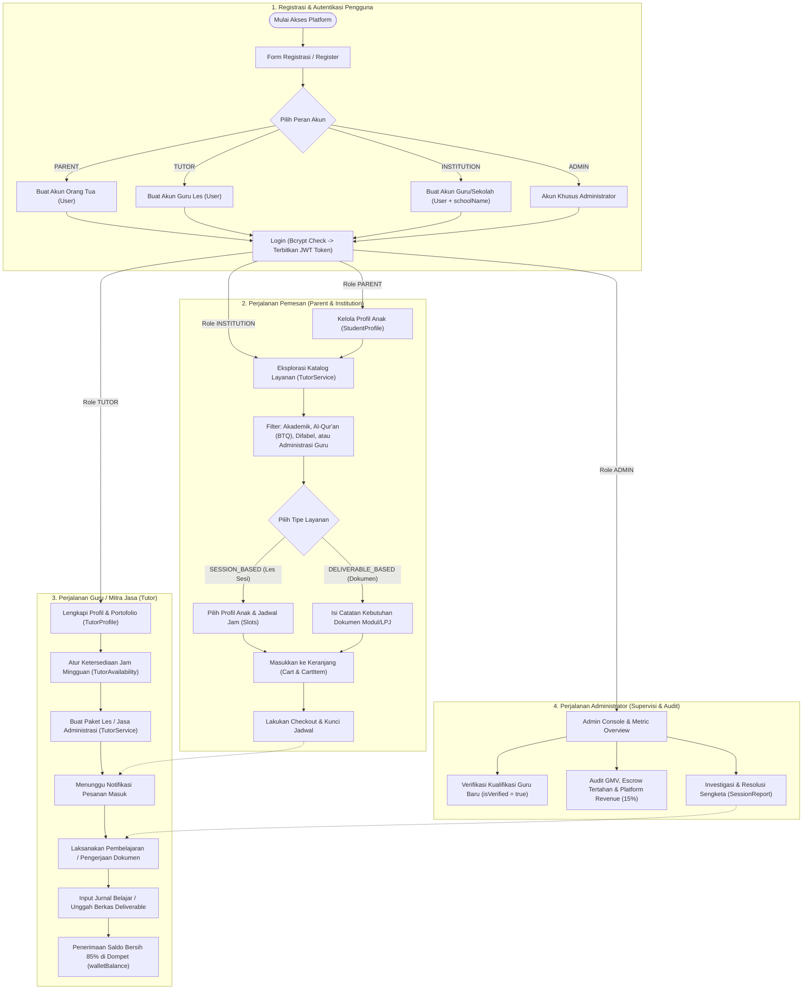
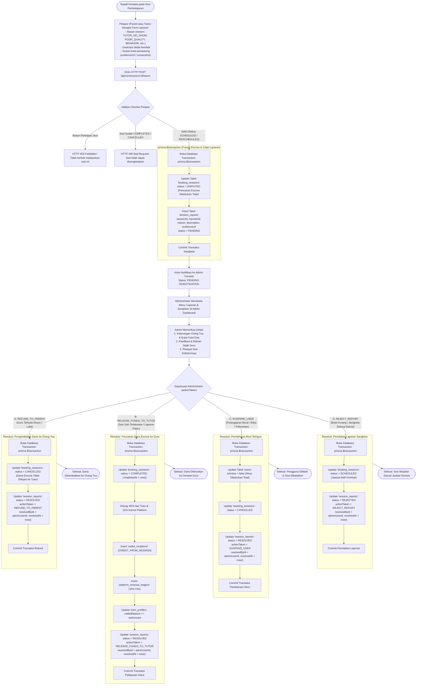

# Dokumentasi Alur Sistem & Diagram Alir (System Flowcharts) Belajar-Ku

Dokumen ini menyajikan pemetaan komprehensif seluruh alur kerja (*workflows*), logika transaksi, proteksi konkurensi, distribusi pendapatan (*escrow*), dan mekanisme penyelesaian sengketa pada platform **Belajar-Ku**.

Seluruh diagram disusun menggunakan sintaks standar **Mermaid.js** (`flowchart TD`) dengan notasi teknis, *decision diamonds*, dan *subgraph* modular yang siap digunakan untuk presentasi arsitektur, *code walkthrough*, maupun audit sistem.

---

## 1. System Macro Flow (High-Level Overview)

Diagram makro ini memetakan perjalanan multi-peran (*multi-role user journeys*) pada platform Belajar-Ku yang mencakup peran **Parent (Orang Tua)**, **Tutor (Guru Les)**, **Institution (Sekolah/Guru)**, dan **Admin Platform**.

---

## 2. Core Transaction & Concurrency Flowchart (Deep-Dive)

Diagram ini mengilustrasikan alur teknis ketika pengguna menekan tombol **"Checkout"**, mulai dari proteksi *race condition* menggunakan **Redis Distributed Slot Locking**, pembuatan pesanan di PostgreSQL dalam transaksi ACID (`prisma.$transaction`), hingga eksekusi *webhook settlement* yang merilis baris `BookingSession` dan membuka kunci Redis.

```mermaid
flowchart TD
    %% Inisiasi Checkout
    ClientStart(["Pengguna Menekan Tombol 'Checkout' di Frontend"]) --> FastifyReq["Kirim HTTP POST /api/v1/orders/checkout"]
    FastifyReq --> AuthVerify{"Validasi JWT & Role (PARENT / INSTITUTION)"}
    
    AuthVerify -- "Tidak Valid" --> Res401["HTTP 401 Unauthorized / 403 Forbidden"]
    AuthVerify -- "Valid" --> CheckCart["Query Cart & CartItem dari Database"]

    CheckCart --> CartEmptyCheck{"Apakah Keranjang Memiliki Item?"}
    CartEmptyCheck -- "Kosong" --> Res400Cart["HTTP 400 Bad Request (Cart is empty)"]
    CartEmptyCheck -- "Ada Item" --> ServiceTypeCheck{"Cek Tipe Layanan di Keranjang"}

    %% Jalur Les Sesi: Proteksi Konkurensi Redis
    ServiceTypeCheck -- "SESSION_BASED" --> CheckPostgresDB["Cek Database: Apakah Sesi Sudah Terjadwal?"]
    CheckPostgresDB --> DBConflictCheck{"Sudah Ada BookingSession Aktif?"}
    DBConflictCheck -- "Ya (Duplikat)" --> Throw409DB["HTTP 409 Conflict: Jadwal guru sudah terpesan"]
    
    DBConflictCheck -- "Tidak" --> PrepareRedisLocks["Susun Format Kunci Redis:<br/>lock:tutor:{tutorId}:slot:{date}:{startTime}"]
    PrepareRedisLocks --> AcquireRedisLock["Eksekusi Atomik Redis:<br/>SET key parentId EX 900 NX"]
    
    AcquireRedisLock --> LockResult{"Apakah Kunci Berhasil Didapat? (NX)"}
    LockResult -- "Gagal (Key Sudah Ada)" --> ReleasePartialLocks["Rollback: Hapus Semua Kunci yang Telah Terpasang (DEL key)"]
    ReleasePartialLocks --> Throw409Redis["HTTP 409 Conflict: Jadwal guru sedang dipesan pengguna lain"]
    
    %% Jalur Lolos Lock atau Deliverable
    LockResult -- "Berhasil (Kunci Aktif 15 Menit)" --> StartPrismaTx["Buka Database Transaction: prisma.$transaction"]
    ServiceTypeCheck -- "DELIVERABLE_BASED" --> StartPrismaTx

    subgraph ACID_Checkout ["prisma.$transaction (Pembuatan Pesanan)"]
        StartPrismaTx --> GenInvoice["Generate Nomor Invoice: INV-{timestamp}-{random}"]
        GenInvoice --> CreateOrder["Insert ke Tabel 'orders':<br/>status = WAITING_PAYMENT<br/>totalAmount = Sum(price)"]
        CreateOrder --> CreateOrderItems["Insert ke Tabel 'order_items':<br/>Snapshot price, slots, maxRevisions, platformFeePercent (15%)"]
        CreateOrderItems --> ClearCart["Delete dari Tabel 'cart_items' (Kosongkan Keranjang)"]
        ClearCart --> CommitCheckoutTx["Commit Transaksi Database"]
    end

    CommitCheckoutTx --> ReturnOrderWaiting["Kirim Respon HTTP 201 Created:<br/>Data Order (Status: WAITING_PAYMENT)<br/>Timer Pembayaran Aktif (15 Menit)"]

    %% Webhook Pembayaran
    ReturnOrderWaiting --> PaymentGateway["Pengguna Membayar via Payment Gateway / Mock Webhook"]
    PaymentGateway --> WebhookTrigger["HTTP POST /api/v1/orders/webhook/payment"]
    WebhookTrigger --> VerifyWebhookSignature{"Status Pembayaran?"}

    %% Pembayaran Gagal / Expired
    VerifyWebhookSignature -- "FAILED / EXPIRED" --> HandleFailedPayment["Update Order: status = CANCELLED"]
    HandleFailedPayment --> ReleaseRedisLocksCancel["Hapus Kunci Redis (DEL lock:tutor:...)"]
    ReleaseRedisLocksCancel --> EndCancelled(["Selesai: Jadwal Terbuka Kembali"])

    %% Pembayaran Berhasil
    VerifyWebhookSignature -- "PAID" --> StartPaymentTx["Buka Database Transaction: prisma.$transaction (Settlement)"]
    
    subgraph ACID_Settlement ["prisma.$transaction (Aktivasi Pesanan & Sesi)"]
        StartPaymentTx --> UpdateOrderStatus["Update Order: status = PAID"]
        UpdateOrderStatus --> CheckItemType{"Tipe Layanan Item?"}
        
        CheckItemType -- "SESSION_BASED" --> LoopSlots["Iterasi Seluruh Snapshot Jadwal (SelectedSlots)"]
        LoopSlots --> InsertBookingSession["Insert ke Tabel 'booking_sessions':<br/>status = SCHEDULED<br/>scheduledDate, startTime, endTime, sessionNumber"]
        InsertBookingSession --> CheckNextSlot{"Masih Ada Slot?"}
        CheckNextSlot -- "Ya" --> LoopSlots
        CheckNextSlot -- "Selesai" --> CommitSettlementTx["Commit Settlement Transaction"]

        CheckItemType -- "DELIVERABLE_BASED" --> SetDeliverableStatus["Update Order: deliverableStatus = AWAITING_DELIVERY"]
        SetDeliverableStatus --> CommitSettlementTx
    end

    CommitSettlementTx --> ReleaseRedisLocksFinal["Hapus Kunci Sementara Redis (DEL lock:tutor:...)<br/>(Jadwal Kini Terkunci Permanen di PostgreSQL)"]
    ReleaseRedisLocksFinal --> OrderPaidSuccess(["Selesai: Pesanan & Jadwal Aktif"])
```

---

## 3. Post-Payment & Escrow Milestone Flowchart (Deep-Dive)

Platform Belajar-Ku menerapkan mekanisme **Escrow Bertahap**:
- **Layanan Berbasis Sesi (*Session-Based*):** Dana dicairkan per sesi secara inkremental setiap kali guru menyelesaikan tatap muka dan mengisi evaluasi belajar (*learning report*).
- **Layanan Berbasis Dokumen (*Deliverable-Based*):** 100% dana ditahan di *escrow* sampai klien memeriksa berkas deliverable terunggah dan menyetujuinya (*Setujui & Selesaikan*).
- **Bagi Hasil:** Pada setiap pencairan, sistem memotong **15% komisi platform** dan meneruskan **85% pendapatan bersih ke dompet tutor**.

```mermaid
flowchart TD
    StartMilestone(["Sesi Terjadwal / Dokumen Siap Dikerjakan"]) --> ServiceBranch{"Identifikasi Tipe Layanan"}

    %% ==========================================
    %% ALUR 1: SESI LES PRIVAT (SESSION_BASED)
    %% ==========================================
    ServiceBranch -- "SESSION_BASED" --> TutorExecutesLesson["Guru & Siswa Melaksanakan Sesi Belajar (Online / Visit)"]
    TutorExecutesLesson --> TutorClicksComplete["Guru Menekan Tombol 'Selesaikan Sesi' di Dashboard"]
    TutorClicksComplete --> OpenJournalModal["Tutor Mengisi Jurnal Belajar (learningReport):<br/>- Evaluasi PAUD: Motorik, fonik, visual<br/>- Evaluasi SMP: Pemahaman konsep, rumus, latihan"]
    
    OpenJournalModal --> SubmitCompleteReq["Kirim HTTP POST /api/v1/sessions/:id/complete"]
    SubmitCompleteReq --> ValidateSessionState{"Validasi Kondisi Sesi"}

    ValidateSessionState -- "Status COMPLETED / CANCELLED / DISPUTED" --> Throw400Session["HTTP 400 Bad Request: Sesi tidak dapat diselesaikan"]
    ValidateSessionState -- "Bukan Tutor Pemilik" --> Throw403Tutor["HTTP 403 Forbidden: Anda bukan pengajar sesi ini"]
    
    ValidateSessionState -- "Valid (Status: SCHEDULED/RESCHEDULED)" --> CalcRevenue["Hitung Pembagian Pendapatan Transaksi:<br/>1. grossAmount = priceSnapshot / totalSessions<br/>2. platformFee (15%) = round(grossAmount * 0.15)<br/>3. netAmount (85%) = grossAmount - platformFee"]

    CalcRevenue --> StartSessionEscrowTx["Buka Database Transaction: prisma.$transaction"]

    subgraph ACID_SessionEscrow ["prisma.$transaction (Pencairan Escrow Sesi)"]
        StartSessionEscrowTx --> UpdateSessionRow["Update Tabel 'booking_sessions':<br/>status = COMPLETED<br/>learningReport = input<br/>completedAt = now()"]
        UpdateSessionRow --> InsertWalletMutation["Insert Tabel 'wallet_mutations':<br/>type = CREDIT_FROM_SESSION<br/>grossAmount, feeDeducted (15%), netAmount (85%), amount = netAmount"]
        InsertWalletMutation --> InsertPlatformLedger["Insert Tabel 'platform_revenue_ledgers':<br/>grossAmount, platformFee (15%)"]
        InsertPlatformLedger --> IncTutorBalance["Update Tabel 'tutor_profiles':<br/>walletBalance = walletBalance + netAmount"]
        IncTutorBalance --> IncCompletedCount["Update Tabel 'order_items':<br/>completedSessions = completedSessions + 1"]
        IncCompletedCount --> CommitSessionTx["Commit Transaksi Pencairan"]
    end

    CommitSessionTx --> SessionDone(["Sesi Selesai: Dana Bersih Masuk ke Dompet Guru"])

    %% ==========================================
    %% ALUR 2: DOKUMEN DELIVERABLE (DELIVERABLE_BASED)
    %% ==========================================
    ServiceBranch -- "DELIVERABLE_BASED" --> TutorUploadsFile["Guru Mengunggah Berkas Hasil Kerja (Maks. 50MB)"]
    TutorUploadsFile --> MultipartUploadPipe["Stream Langsung ke Persistent Volume (/app/uploads/)<br/>Validasi Format: .docx, .pdf, .xlsx, .zip"]
    MultipartUploadPipe --> CreateOrderAttachment["Insert 'order_attachments' & Update Order deliverableStatus = DELIVERED"]
    
    CreateOrderAttachment --> ClientReview{"Klien (Parent/Institution) Meninjau Dokumen"}
    
    ClientReview -- "Butuh Perbaikan (Maks. 2x)" --> ReqRevision["Klien Mengajukan Revisi (HTTP POST /request-revision)<br/>deliverableStatus = REVISION_REQUESTED"]
    ReqRevision --> TutorRevises["Guru Memperbaiki & Mengunggah Ulang Dokumen"]
    TutorRevises --> CreateOrderAttachment

    ClientReview -- "Disetujui (Puas)" --> ApproveDeliverable["Klien Klik 'Setujui & Selesaikan' (HTTP POST /complete-deliverable)"]
    ApproveDeliverable --> CalcDeliverableRev["Hitung Pembagian Nilai Total Order:<br/>grossAmount = totalAmount<br/>platformFee = grossAmount * 15%<br/>netAmount = grossAmount - 15%"]

    CalcDeliverableRev --> StartDeliverableTx["Buka Database Transaction: prisma.$transaction"]

    subgraph ACID_DeliverableEscrow ["prisma.$transaction (Pencairan Escrow Deliverable)"]
        StartDeliverableTx --> UpdateDeliverableStatus["Update 'orders' & 'order_items':<br/>deliverableStatus = COMPLETED"]
        UpdateDeliverableStatus --> InsertDelivMutation["Insert Tabel 'wallet_mutations':<br/>type = CREDIT_FROM_DELIVERABLE<br/>grossAmount, feeDeducted (15%), netAmount (85%)"]
        InsertDelivMutation --> InsertDelivLedger["Insert Tabel 'platform_revenue_ledgers':<br/>orderId, grossAmount, platformFee (15%)"]
        InsertDelivLedger --> IncDelivTutorBalance["Update Tabel 'tutor_profiles':<br/>walletBalance = walletBalance + netAmount"]
        IncDelivTutorBalance --> CommitDelivTx["Commit Transaksi Deliverable"]
    end

    CommitDelivTx --> DeliverableDone(["Deliverable Selesai: Dana Masuk ke Dompet Guru"])

    %% Dashboard Visibility
    SessionDone --> ParentDashboardView["Orang Tua Melihat Status COMPLETED & Membaca Evaluasi Guru di Dashboard"]
    DeliverableDone --> ParentDashboardView
```

---

## 4. Dispute & Grievance Resolution Flowchart (Mermaid.js)

Bila terjadi ketidaksesuaian pelaksanaan pembelajaran (misal: guru tidak hadir, materi tidak sesuai, atau kendala etika), Orang Tua atau Guru dapat mengajukan komplain resmi (*Dispute*). Diagram di bawah ini memetakan pembekuan dana *escrow*, investigasi bukti oleh Administrator, dan 4 cabang keputusan (*Admin Actions*).

---

## 5. Matriks Status Transisi & Ringkasan Teknis (State Transitions)

Berikut adalah tabel transisi status entitas utama yang menjelaskan pemicu (*triggers*) dan dampak perubahan status pada data keuangan platform:

| Entitas Model | Status Awal | Status Tujuan | Event / Pemicu (*Trigger*) | Dampak Finansial & Operasional |
| :--- | :--- | :--- | :--- | :--- |
| **`Order`** | *(None)* | `WAITING_PAYMENT` | Checkout keranjang berhasil divalidasi. | Kunci Redis dipasang (TTL 15 menit), total harga dibekukan di `order_items`. |
| **`Order`** | `WAITING_PAYMENT` | `PAID` | Webhook pembayaran sukses diterima. | Transaksi ACID menerbitkan baris `booking_sessions`, kunci Redis dilepas. |
| **`Order`** | `WAITING_PAYMENT` | `CANCELLED` | Pembayaran gagal atau kedaluwarsa (> 15 menit). | Kunci Redis slot tutor dihapus seketika agar dapat dipesan pengguna lain. |
| **`BookingSession`** | *(None)* | `SCHEDULED` | Hasil auto-generate saat order berstatus `PAID`. | Dana tersimpan aman di *escrow* platform (`heldEscrow`). |
| **`BookingSession`** | `SCHEDULED` | `COMPLETED` | Guru menyelesaikan sesi & mengisi `learningReport`. | **85%** masuk ke `walletBalance` guru (`CREDIT_FROM_SESSION`), **15%** masuk ke `platform_revenue_ledgers`. |
| **`BookingSession`** | `SCHEDULED` | `DISPUTED` | Orang Tua atau Guru mengajukan komplain (`SessionReport`). | **Pencairan dana escrow dibekukan**; status terkunci hingga ada putusan Admin. |
| **`BookingSession`** | `DISPUTED` | `CANCELLED` | Admin memutuskan `REFUND_TO_PARENT` atau `SUSPEND_USER`. | Dana escrow dikembalikan ke orang tua; guru tidak mendapatkan kredit. |
| **`BookingSession`** | `DISPUTED` | `COMPLETED` | Admin memutuskan `RELEASE_FUNDS_TO_TUTOR`. | Escrow dicairkan: 85% ke dompet guru, 15% pendapatan platform. |
| **`BookingSession`** | `DISPUTED` | `SCHEDULED` | Admin memutuskan `REJECT_REPORT`. | Laporan ditolak; sesi diaktifkan kembali untuk dijadwalkan ulang / dilanjutkan. |
| **`DeliverableStatus`** | `AWAITING_DELIVERY` | `DELIVERED` | Tutor mengunggah berkas via streaming multipart 50MB. | Berkas fisik tersimpan di `/app/uploads/deliverables/`; klien dapat mengunduh. |
| **`DeliverableStatus`** | `DELIVERED` | `REVISION_REQUESTED` | Klien meminta perbaikan (maksimal 2 kali revisi). | Escrow tetap ditahan; tutor menerima instruksi catatan revisi. |
| **`DeliverableStatus`** | `DELIVERED` | `COMPLETED` | Klien menekan tombol *"Setujui & Selesaikan"*. | 100% escrow dilepas: 85% ke dompet tutor (`CREDIT_FROM_DELIVERABLE`), 15% platform cut. |
